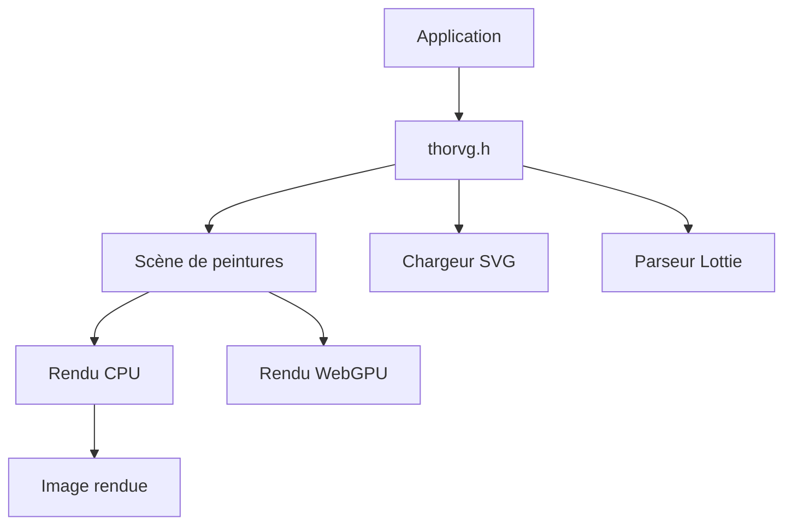

# thorvg/thorvg

> Moteur de graphisme vectoriel C++ léger, avec rendu SVG et Lottie, du microcontrôleur au web.

## Le problème
Afficher des animations vectorielles sur des appareils à faibles ressources sans embarquer un gros moteur graphique.

## Ce que ça fait vraiment
Une API publique construit un graphe de scène, des chargeurs lisent SVG, Lottie et images, puis un moteur de rendu (CPU avec SIMD, OpenGL, WebGL, WebGPU) rastérise. Le cœur peut descendre vers 170 Ko. Des liaisons C et plusieurs projets associés existent.

## Comment c'est branché


## Essayer
```bash
meson setup builddir
ninja -C builddir install
meson setup builddir -Dloaders="lottie, ..."
meson setup builddir -Dbindings="capi"
```

## Coût et pièges
Gratuit (MIT). Il faut Meson et Ninja ; WebGPU exige wgpu-native. Les comparaisons de vitesse sont des mesures internes, sur Apple M1/M2.

## Ce que ce n'est pas
Pas un outil de dessin ni un lecteur final : c'est un moteur à intégrer. Les expressions Lottie sont désactivées par défaut.

## Alternatives
Skia, mentionné dans le README comme point de comparaison des performances.

## Pour toi
À ignorer : moteur graphique pour interfaces et jeux, sans lien avec un profil data / IA / MLOps.

