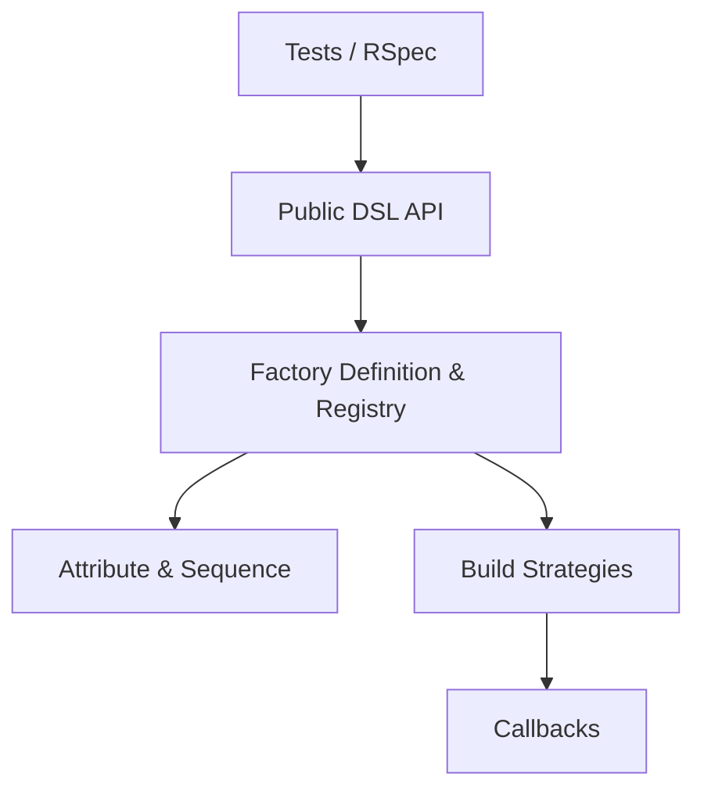

# thoughtbot/factory_bot

> Fixture replacement for Ruby tests, with multiple build strategies and inheritance.

## The problem
Static fixtures are rigid and hard to evolve in a test suite.

## What it actually does
You declare object factories with a DSL (traits, sequences, callbacks, inheritance). At use time, you pick a strategy: saved instance, unsaved instance, attributes hash or stubbed object. A linter checks the definitions.

## How it is wired


## Trying it
```bash
bundle add factory_bot
gem install factory_bot
```

## Cost and gotchas
Free. For Rails, the separate factory_bot_rails gem is needed. No key or service.

## What it is not
It is not a random test data generator nor a synthetic data tool for AI: it builds Ruby objects for tests.

## Alternatives
No alternative named in the README.

## For you
Ignore: Ruby testing library, with no use in a Python data/AI workflow.
