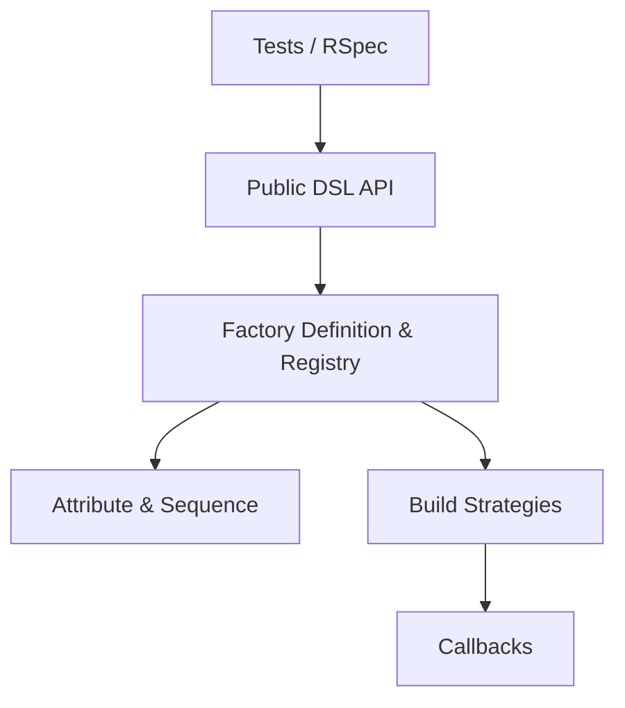

# thoughtbot/factory_bot

> Remplaçant des fixtures pour tests Ruby, avec stratégies de construction multiples et héritage.

## Le problème
Les fixtures figées sont rigides et difficiles à faire évoluer dans une suite de tests.

## Ce que ça fait vraiment
On déclare des fabriques d'objets avec un DSL (traits, séquences, callbacks, héritage). À l'usage, on choisit une stratégie : instance sauvée, non sauvée, hash d'attributs ou objet simulé. Un linter vérifie les définitions.

## Comment c'est branché


## Essayer
```bash
bundle add factory_bot
gem install factory_bot
```

## Coût et pièges
Gratuit. Pour Rails, il faut le gem séparé factory_bot_rails. Aucune clé ni service.

## Ce que ce n'est pas
Ce n'est pas un générateur de données de test aléatoires ni un outil de données synthétiques pour l'IA : il construit des objets Ruby pour des tests.

## Alternatives
Aucune alternative nommée dans le README.

## Pour toi
À ignorer : bibliothèque de tests Ruby, sans usage dans un flux data/IA en Python.

