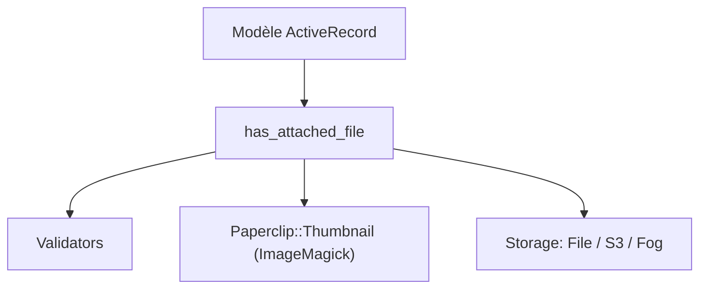

# thoughtbot/paperclip

> Deprecated Ruby gem for attaching files to ActiveRecord models, replaced by ActiveStorage.

## The problem
Handling file uploads, thumbnails and storage on Rails models requires a lot of repetitive code.

## What it actually does
`has_attached_file` declares an attachment, with validations (type, size, presence), thumbnail styles via ImageMagick, disk, S3 or Fog storage, custom processors and callbacks. It checks the content type to limit spoofing.

## How it is wired
Simplified diagram based on the sheet, no diagram provided.


## Trying it
```bash
gem "paperclip", "~> 6.0.0"
rails generate paperclip user avatar
```

## Cost and gotchas
Free. Ruby 2.1+ and Rails 4.2+, ImageMagick and the `file` command must be installed. Repo archived, no more PRs except for the migration guide. License not identified by GitHub.

## What it is not
Not maintained: bugs go to the kt-paperclip fork. Not for new projects.

## Alternatives
ActiveStorage (Rails), kt-paperclip (fork maintained by Kreeti).

## For you
Ignore: deprecated Ruby gem, unrelated to a data / AI / MLOps profile.
