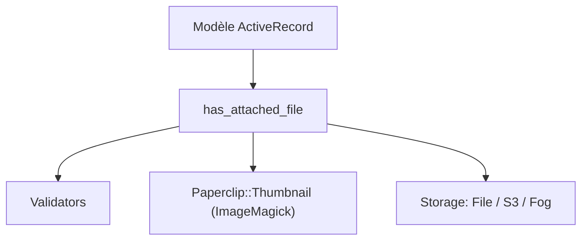

# thoughtbot/paperclip

> Gem Ruby déprécié pour attacher des fichiers à des modèles ActiveRecord, remplacé par ActiveStorage.

## Le problème
Gérer envois de fichiers, miniatures et stockage sur des modèles Rails demande beaucoup de code répétitif.

## Ce que ça fait vraiment
`has_attached_file` déclare une pièce jointe, avec validations (type, taille, présence), styles de miniatures via ImageMagick, stockage disque, S3 ou Fog, processeurs personnalisés et callbacks. Il vérifie le type de contenu pour limiter l'usurpation.

## Comment c'est branché
Schéma simplifié d'après la fiche, sans diagramme fourni.


## Essayer
```bash
gem "paperclip", "~> 6.0.0"
rails generate paperclip user avatar
```

## Coût et pièges
Gratuit. Ruby 2.1+ et Rails 4.2+, ImageMagick et la commande `file` à installer. Dépôt archivé, plus de PR sauf pour le guide de migration. Licence non identifiée par GitHub.

## Ce que ce n'est pas
Pas maintenu : les bugs vont vers le fork kt-paperclip. Pas pour les nouveaux projets.

## Alternatives
ActiveStorage (Rails), kt-paperclip (fork maintenu par Kreeti).

## Pour toi
Ignorer : gem Ruby dépréciée, sans rapport avec un profil data / IA / MLOps.

