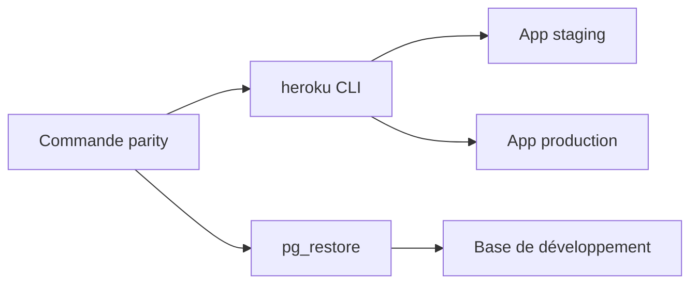

# thoughtbot/parity

> Shell commands to keep development, staging and production in sync for apps hosted on Heroku.

## The problem
Backing up, restoring and deploying between Heroku environments requires long, repetitive commands.

## What it actually does
Ruby gem that exposes shortcuts: `production backup`, `development restore production`, `staging deploy`, `production console`, `migrate`, `tail`. Other commands are passed through as-is to `heroku`. A `--parallelize` option speeds up restoration. Additional environments are declared through a binstub.

## How it is wired
Simplified diagram based on the note, no diagram provided.


## Trying it
```bash
gem install parity
production backup
development restore production
staging deploy
```

## Cost and gotchas
Free, but requires Heroku applications, the git, heroku and pg_restore programs, `staging` and `production` remotes, and a `config/database.yml`. Non-production deployments use `git push --force`.

## What it is not
Not a schema migration tool: the README points to Heroku's release phase. It only serves Heroku. Last push in May 2025.

## Alternatives
No alternative named in the README.

## For you
Ignore: tied to Heroku and Ruby, of little relevance to data / AI pipelines, and not very active.
