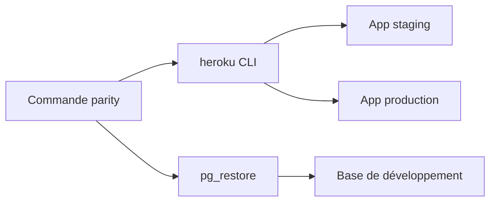

# thoughtbot/parity

> Commandes shell pour synchroniser développement, staging et production d'applications hébergées sur Heroku.

## Le problème
Sauvegarder, restaurer et déployer entre environnements Heroku demande de longues commandes répétitives.

## Ce que ça fait vraiment
Gem Ruby qui expose des raccourcis : `production backup`, `development restore production`, `staging deploy`, `production console`, `migrate`, `tail`. Les autres commandes passent telles quelles à `heroku`. Une option `--parallelize` accélère la restauration. Les environnements supplémentaires se déclarent par un binstub.

## Comment c'est branché
Schéma simplifié d'après la fiche, sans diagramme fourni.


## Essayer
```bash
gem install parity
production backup
development restore production
staging deploy
```

## Coût et pièges
Gratuit, mais exige des applications Heroku, les programmes git, heroku et pg_restore, des remotes `staging` et `production`, et un `config/database.yml`. Les déploiements hors production utilisent `git push --force`.

## Ce que ce n'est pas
Pas un outil de migration de schéma : le README renvoie à la release phase d'Heroku. Il ne sert qu'à Heroku. Dernier push en mai 2025.

## Alternatives
Aucune alternative nommée dans le README.

## Pour toi
À ignorer : lié à Heroku et à Ruby, peu pertinent pour des pipelines data / IA, et peu actif.

