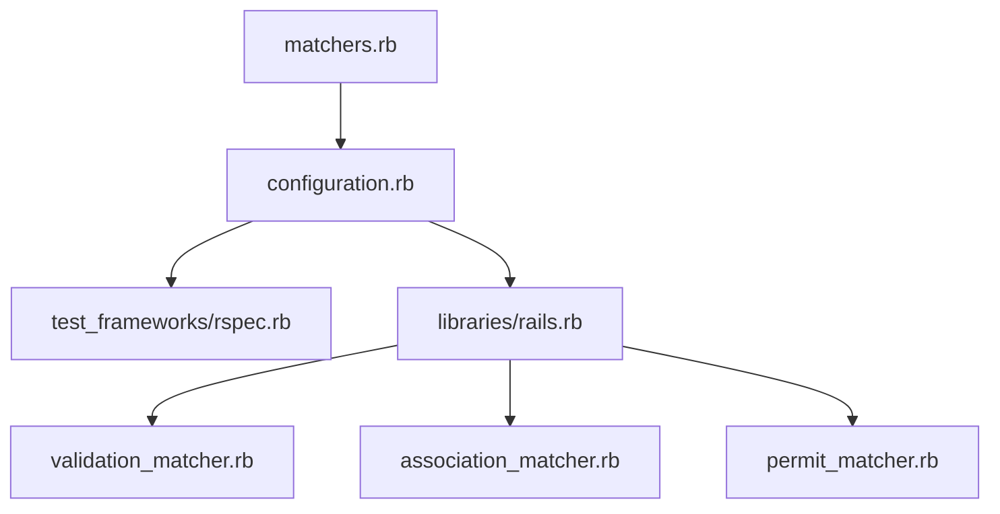

# thoughtbot/shoulda-matchers

> One-line assertions, compatible with RSpec and Minitest, to test common Rails features.

## The problem
Hand-writing tests for Rails validations, associations or controllers is long and error-prone.

## What it actually does
- ActiveModel, ActiveRecord and ActionController matchers, and a routing matcher.
- Examples: `validate_presence_of`, `belong_to`, `permit`, `redirect_to`.
- Configuration that links your test framework (RSpec or Minitest) to Rails.
- Tested with Ruby 3.3+, Rails 7.2+.

## How it is wired


## Trying it
```ruby
group :test do
  gem 'shoulda-matchers', '~> 8.0'
end
```
Then `bundle install` and the `Shoulda::Matchers.configure` setup from the README.

## Cost and gotchas
Free. Real requirement: Ruby and Rails. Older versions require pinning an older version of the gem.

## What it is not
Not a tool for testing business logic: the README says so itself. It mostly checks Rails configuration.

## Alternatives
No alternative named in the README (the shoulda-matchers-cucumber extension exists for Cucumber).

## For you
Ignore unless you use a Rails stack: it does not help test data pipelines.
