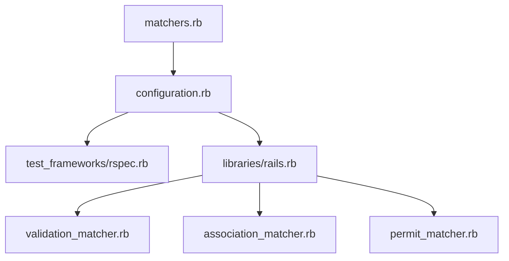

# thoughtbot/shoulda-matchers

> Assertions en une ligne, compatibles RSpec et Minitest, pour tester les fonctions courantes de Rails.

## Le problème
Écrire à la main des tests de validations, d'associations ou de contrôleurs Rails est long et sujet aux erreurs.

## Ce que ça fait vraiment
- Matchers ActiveModel, ActiveRecord et ActionController, et un matcher de routes.
- Exemples : `validate_presence_of`, `belong_to`, `permit`, `redirect_to`.
- Configuration qui relie ton framework de test (RSpec ou Minitest) à Rails.
- Testé avec Ruby 3.3+, Rails 7.2+.

## Comment c'est branché


## Essayer
```ruby
group :test do
  gem 'shoulda-matchers', '~> 8.0'
end
```
Puis `bundle install` et la configuration `Shoulda::Matchers.configure` du README.

## Coût et pièges
Gratuit. Besoin réel : Ruby et Rails. Les anciennes versions exigent d'épingler une version plus ancienne de la gem.

## Ce que ce n'est pas
Pas un outil pour tester la logique métier : le README le dit lui-même. Il vérifie surtout la configuration Rails.

## Alternatives
Aucune alternative nommée dans le README (l'extension shoulda-matchers-cucumber existe pour Cucumber).

## Pour toi
À ignorer sauf pile Rails : il n'aide pas à tester des pipelines de données.

