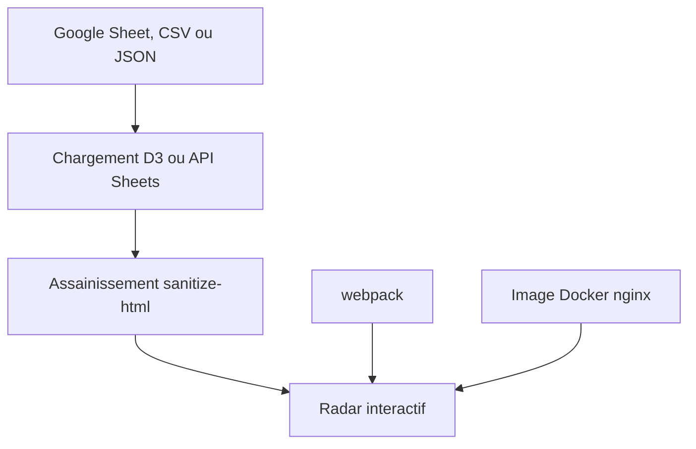

# thoughtworks/build-your-own-radar

> Interactive technology radar generator from a Google Sheet, a CSV or a JSON.

## The problem
Publishing a clear view of technologies to adopt or avoid requires a dedicated visualization tool.

## What it actually does
Generates an interactive radar from a public or private Google Sheet, a CSV or a JSON, with columns `name`, `ring`, `quadrant`, `isNew`, `description` (and optional `status`). Rings and quadrants can be customized on a self-hosted instance. Data is sanitized with an HTML tag whitelist.

## How it is wired
Simplified diagram based on the sheet, no diagram provided.



## Trying it
```bash
docker pull wwwthoughtworks/build-your-own-radar
docker run --rm -p 8080:80 -e CLIENT_ID="[Google Client ID]" wwwthoughtworks/build-your-own-radar:latest
git clone git@github.com:thoughtworks/build-your-own-radar.git
npm install
npm run dev
```

## Cost and gotchas
Free. A private sheet requires a Google OAuth client ID. AGPL-3.0. The last push dates from April 2026.

## What it is not
Not an analysis tool: it formats data that has already been written. The "Hold" ring has become "Caution".

## Alternatives
No alternative named in the README.

## For you
Worth watching: handy for mapping a data/MLOps stack as a team, with no technical stakes; beware of the AGPL if a modified version is deployed.
