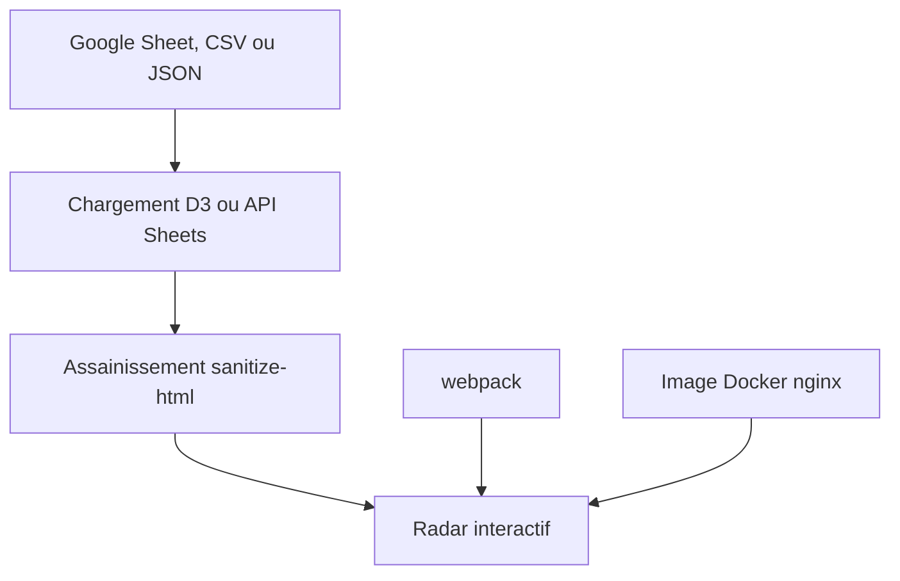

# thoughtworks/build-your-own-radar

> Générateur de radar technologique interactif à partir d'une feuille Google, d'un CSV ou d'un JSON.

## Le problème
Publier une vue claire des technologies à adopter ou éviter demande un outil de visualisation dédié.

## Ce que ça fait vraiment
Génère un radar interactif depuis un Google Sheet public ou privé, un CSV ou un JSON, avec colonnes `name`, `ring`, `quadrant`, `isNew`, `description` (et `status` optionnel). Les anneaux et quadrants sont personnalisables sur une instance auto-hébergée. Les données sont assainies par liste blanche de balises HTML.

## Comment c'est branché
Schéma simplifié d'après la fiche, sans diagramme fourni.



## Essayer
```bash
docker pull wwwthoughtworks/build-your-own-radar
docker run --rm -p 8080:80 -e CLIENT_ID="[Google Client ID]" wwwthoughtworks/build-your-own-radar:latest
git clone git@github.com:thoughtworks/build-your-own-radar.git
npm install
npm run dev
```

## Coût et pièges
Gratuit. Une feuille privée exige un identifiant client OAuth Google. AGPL-3.0. Le dernier push date d'avril 2026.

## Ce que ce n'est pas
Pas un outil d'analyse : il met en forme des données déjà rédigées. L'anneau « Hold » est devenu « Caution ».

## Alternatives
Aucune alternative nommée dans le README.

## Pour toi
À surveiller : pratique pour cartographier une pile data/MLOps en équipe, sans enjeu technique ; attention à l'AGPL en cas de modification déployée.

