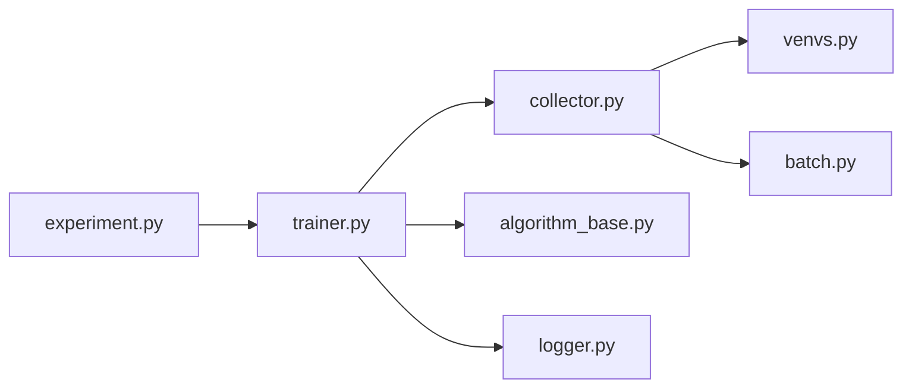

# thu-ml/tianshou

> Reinforcement learning library built on PyTorch and Gymnasium, for researchers and practitioners.

## The problem
RL libraries often have complex code, an impractical high-level API or limited speed.

## What it actually does
Offers a high-level API (`ExperimentBuilder`) and a procedural API. Implements DQN and variants, PPO, SAC, TD3, plus offline RL (CQL, BCQ), imitation, GAIL, prioritized replay. Vectorized environments (EnvPool), TensorBoard and W&B logging. Version 2 separates `Algorithm` and `Policy` and breaks compatibility.

## How it is wired


## Trying it
```bash
git clone git@github.com:thu-ml/tianshou.git
cd tianshou
poetry install
pip install tianshou
```

## Cost and gotchas
Python 3.11+. The README says the PyPI package is "far behind the master". Migration from v1 required.

## What it is not
Not a catalog of environments. Multi-agent and model-based are experimental.

## Alternatives
- Stable-Baselines3, Ray/RLlib, SpinningUp, Dopamine, ACME, Sample Factory: compared in the README table.

## For you
Adopt for reproducible RL experiments: MIT, backed by appliedAI, full training tests.
