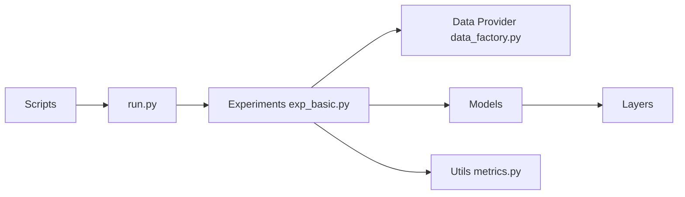

# thuml/Time-Series-Library

> PyTorch codebase for evaluating and developing deep time-series models.

## The problem
Comparing time-series models fairly requires the same data, windows and metrics for all of them.

## What it actually does
Five unified tasks: long/short-term forecasting, imputation, anomaly detection, classification.
40+ models (TimesNet, iTransformer, PatchTST, DLinear, TimeXer, Mamba…) and zero-shot evaluation of foundation models (Chronos, TimesFM, Moirai, Sundial…).
`run.py` chooses the experiment according to `task_name`; bash scripts reproduce the papers' configurations.
Adding a model = one file in `models/` and one script.

## How it is wired


## Trying it
```bash
git clone https://github.com/thuml/Time-Series-Library.git
cd Time-Series-Library
conda create -n tslib python=3.11
pip install torch==2.5.1 --index-url https://download.pytorch.org/whl/cu121
pip install -r requirements.txt
bash ./scripts/long_term_forecast/ETT_script/TimesNet_ETTh1.sh
```

## Cost and gotchas
Free; PyTorch tied to your CUDA version, Mamba Linux only. Data to be downloaded separately.

## What it is not
No more active new features (April 2026); benchmarks are partly saturated according to the authors.

## Alternatives
- thuml/OpenLTM: pre-training/fine-tuning paradigm for large time-series models.

## For you
To adopt as a test bench for time-series baselines: correct and reproducible implementations, while keeping a critical eye on the benchmarks.
