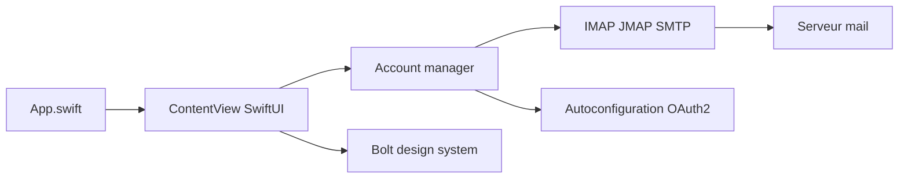

# thunderbird/thunderbird-ios

> Thunderbird's native iOS mail client, still at the foundation stage and non-functional.

## The problem
Thunderbird does not exist on iOS; the project wants to bring a mail client focused on triage and desktop integration.

## What it actually does
The README admits that the application is neither functional nor ready, the immediate goal being a TestFlight version. Based on the code: a SwiftUI app, a Swift package `Core` (accounts, automatic DNS/OAuth2 discovery, IMAP, JMAP and SMTP clients, MIME parser) and a `Bolt` package for the design.

## How it is wired

## Trying it
No command documented in the README.

## Cost and gotchas
Xcode and a Mac are required to build. No stable installable version announced; TestFlight targeted first, App Store later.

## What it is not
Not a usable client today: reading and writing mail will come later.

## Alternatives
No alternative named in the README.

## For you
Ignore: non-functional iOS mail client, unrelated to data or AI.
