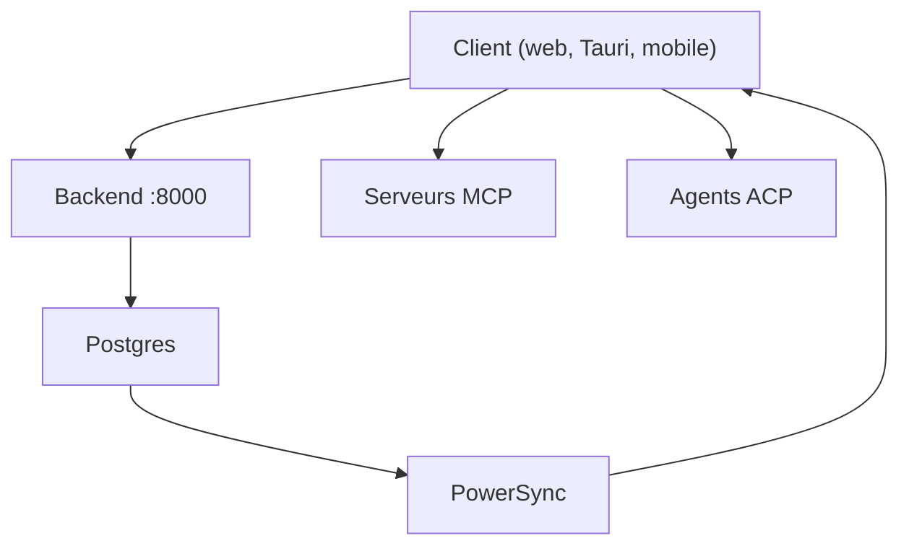

# thunderbird/thunderbolt

> Open source cross-platform AI client, deployable on-premises, to choose your models and keep your data.

## The problem
AI chat clients lock the user in with a model provider and keep their data; an organization wants to keep its own.

## What it actually does
Web, mobile and desktop application (Mac, Linux, Windows) compatible with remote, local or on-premises models. It offers projects, skills, widgets, HTML artifacts, MCP connections, ACP agents, and multi-device synchronization on local SQLite with optional end-to-end encryption. A backend and PowerSync run in Docker.

## How it is wired

Simplified diagram based on the sheet, no diagram provided.

## Trying it
```bash
make doctor    # verify your tools
make setup     # install frontend + backend dependencies
make up        # start Postgres + PowerSync in Docker
make run       # start the backend (:8000) and frontend (:1420)
```

## Cost and gotchas
Docker and a dev toolchain are required. The models used remain at your expense depending on the provider chosen. The README points to a page on telemetry, and to an option to turn it off.

## What it is not
It is not a model: it is a client. The README admits that docs, community and roadmap are under construction; paid enterprise features exist.

## Alternatives
No alternative named in the README.

## For you
Keep an eye on it: the idea of a controlled, self-hostable AI client is useful to an MLOps profile, but the repo is a year old and its framework is still being built.
