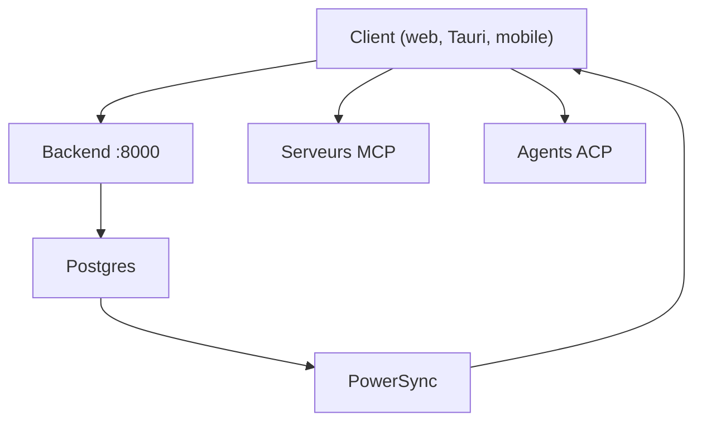

# thunderbird/thunderbolt

> Client IA open source multiplateforme, déployable sur site, pour choisir ses modèles et garder ses données.

## Le problème
Les clients de chat IA enferment l'utilisateur chez un fournisseur de modèles et gardent ses données ; une organisation veut les siens.

## Ce que ça fait vraiment
Application web, mobile et bureau (Mac, Linux, Windows) compatible avec des modèles distants, locaux ou sur site. Elle propose projets, skills, widgets, artefacts HTML, connexions MCP, agents ACP, synchronisation multi-appareils sur SQLite local avec chiffrement de bout en bout optionnel. Un backend et PowerSync tournent dans Docker.

## Comment c'est branché

Schéma simplifié d'après la fiche, sans diagramme fourni.

## Essayer
```bash
make doctor    # verify your tools
make setup     # install frontend + backend dependencies
make up        # start Postgres + PowerSync in Docker
make run       # start the backend (:8000) and frontend (:1420)
```

## Coût et pièges
Docker et chaîne de dev requis. Les modèles utilisés restent à ta charge selon le fournisseur choisi. Le README renvoie à une page sur la télémétrie, et à une option pour la couper.

## Ce que ce n'est pas
Ce n'est pas un modèle : c'est un client. Le README admet que docs, communauté et feuille de route sont en chantier ; des fonctions entreprise payantes existent.

## Alternatives
Aucune alternative nommée dans le README.

## Pour toi
À surveiller : l'idée d'un client IA maîtrisé et auto-hébergeable est utile à un profil MLOps, mais le dépôt a un an et son cadre est encore en construction.

