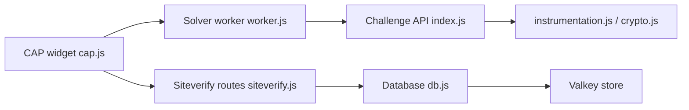

# tiagozip/cap

> Open source proof-of-work alternative to visual CAPTCHAs, for web developers.

## The problem
Visual CAPTCHAs annoy visitors, are heavy, and go through third-party services that raise privacy concerns.

## What it actually does
A browser widget (~20 KB according to the README) requests a challenge, solves it in a worker (with a WASM solver) and sends back the result. The server validates through a `siteverify` route. A "standalone" mode in a Docker container adds an admin dashboard and a configuration API. "Instrumentation" checks complement the proof of work.

## How it is wired

## Trying it
The README gives no command: it states that the default path is the "Standalone" Docker container and points to the online documentation and a demo (Railway deployment).

## Cost and gotchas
Free, no telemetry announced. You must host the standalone container (and a Valkey according to the architecture). The README claims Apache 2.0, but GitHub does not identify the license: check before use.

## What it is not
Not an absolute anti-bot protection: proof of work makes an attack more expensive without making it impossible. The "250x lighter than hCaptcha" is a README claim, not measured here.

## Alternatives
- reCAPTCHA: widely used Google service.
- hCaptcha: commercial third-party service, already widely integrated.
- Cloudflare Turnstile: free and with no hosting on your side.

## For you
Worth watching: useful if you expose a public form or API, but the project is young, maintained by one person and its license is not confirmed.
