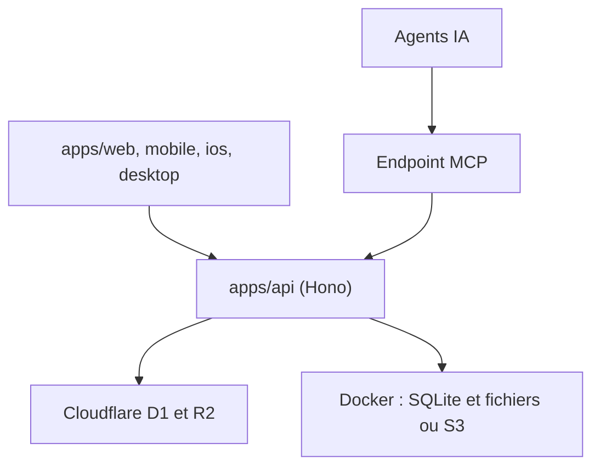

# tianma-if/edgeever

> Three-pane knowledge base and note-taking app, with native MCP, on Cloudflare or Docker.

## The problem
Evernote has become heavy and expensive, Obsidian syncs poorly, and few open tools expose your notes to AI agents.

## What it actually does
Rich or Markdown editor, notebooks, tags, full-text search, offline sync to a Hono server. A remote MCP endpoint lets agents (Claude Code, Cursor) read and write notes. Web, desktop (Electron), Android, iOS clients and a clipping extension. Import from Evernote, Obsidian, Joplin.

## How it is wired


## Trying it
```bash
curl -fsSL https://edgeever.org/install.sh | bash
bun install
bun run dev
```

## Cost and gotchas
The free Cloudflare plan is enough, but enabling R2 requires a payment method. The AI features work with your own key (OpenAI, Claude, Gemini). The install script should be audited before running. AGPL license.

## What it is not
Not a product affiliated with Evernote. The public demo is reset every day: do not put anything private in it. Young project (created in 2026).

## Alternatives
Evernote, Obsidian, Joplin, Memos and SiYuan, compared in the README.

## For you
Worth watching: an MCP endpoint to feed your agents with your notes is attractive, but the repository is recent, and the AGPL weighs on you if you integrate it.
