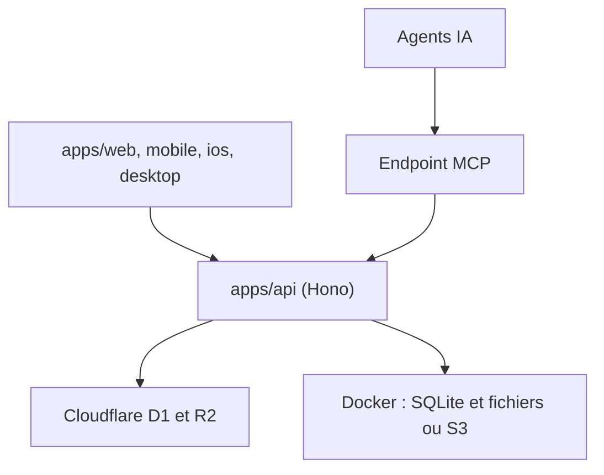

# tianma-if/edgeever

> Base de connaissances et prise de notes à trois panneaux, avec MCP natif, sur Cloudflare ou Docker.

## Le problème
Evernote est devenu lourd et cher, Obsidian synchronise mal, et peu d'outils ouverts exposent tes notes à des agents IA.

## Ce que ça fait vraiment
Éditeur riche ou Markdown, notebooks, tags, recherche plein texte, synchronisation hors ligne vers un serveur Hono. Un point MCP distant permet à des agents (Claude Code, Cursor) de lire et écrire les notes. Clients web, bureau (Electron), Android, iOS et extension de clipping. Import depuis Evernote, Obsidian, Joplin.

## Comment c'est branché


## Essayer
```bash
curl -fsSL https://edgeever.org/install.sh | bash
bun install
bun run dev
```

## Coût et pièges
Le plan gratuit Cloudflare suffit, mais activer R2 demande un moyen de paiement. Les fonctions IA fonctionnent avec ta propre clé (OpenAI, Claude, Gemini). Le script d'installation est à auditer avant exécution. Licence AGPL.

## Ce que ce n'est pas
Pas un produit affilié à Evernote. La démo publique est réinitialisée chaque jour : n'y mets rien de privé. Projet jeune (créé en 2026).

## Alternatives
Evernote, Obsidian, Joplin, Memos et SiYuan, comparés dans le README.

## Pour toi
À surveiller : un point MCP pour nourrir tes agents avec tes notes est attrayant, mais le dépôt est récent, et l'AGPL pèse si tu l'intègres.

