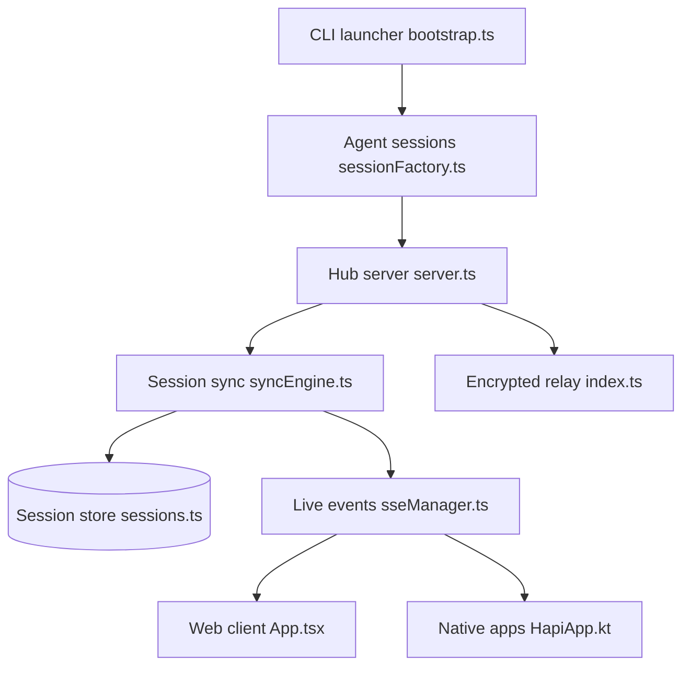

# tiann/hapi

> Remotely drive, from a phone or browser, your coding agent sessions (Claude Code, Codex, Cursor…) launched on your machine.

## The problem
A coding agent running in a terminal forces you to stay at your workstation to approve its permission requests.

## What it actually does
HAPI wraps the official agent instead of replacing it. A hub synchronizes the session, and a web/PWA client, a native app or a Telegram Mini App lets you read the chat, approve, open a terminal or browse files. An encrypted relay (WireGuard + TLS) is offered, or Cloudflare Tunnel / Tailscale for self-hosting. The license is AGPL-3.0.

## How it is wired
Simplified schema based on the supplied diagram (relationships largely unverified in the code).



## Trying it
```bash
npx @twsxtd/hapi hub --relay     # start hub with E2E encrypted relay
npx @twsxtd/hapi                 # choose an agent and start a session
```

## Cost and gotchas
The web client is free, the native iOS/Android apps are paid. The agent in question must already be installed, and the AGPL-3.0 license should be read before any commercial use. 341 open issues.

## What it is not
It is not an agent: it drives the ones you already have. It is not cloud hosting for agents, your code stays on your machine. The README points to Happy as the original project.

## Alternatives
- Happy: the project of which HAPI presents itself as the local-first alternative (comparison in "Why Not Happy?").

## For you
Worth watching: useful if you run long agents and want to approve them from your phone, but the AGPL and the volume of issues call for a cautious trial.
