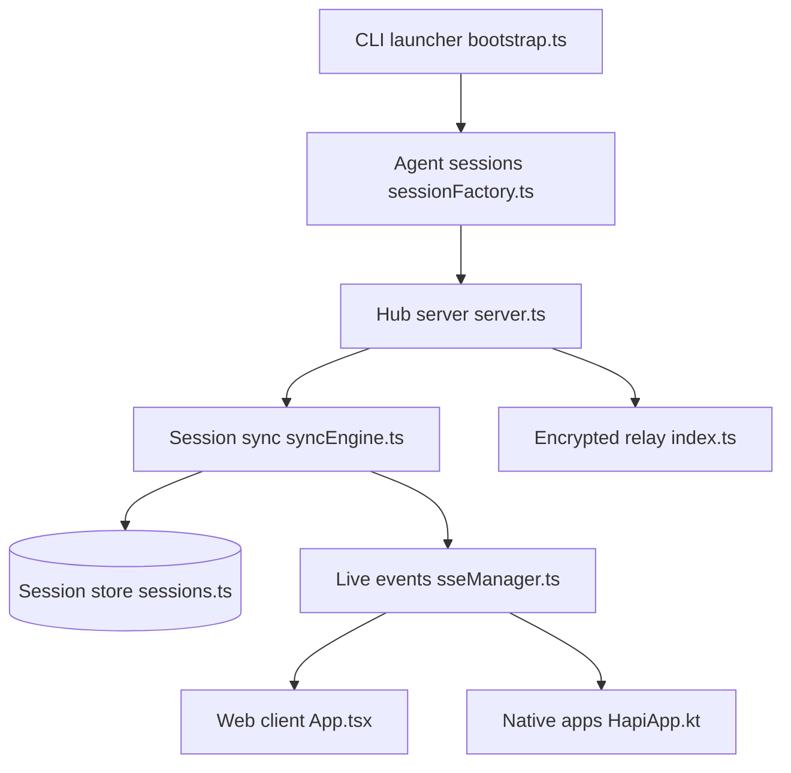

# tiann/hapi

> Pilote à distance, depuis téléphone ou navigateur, tes sessions d'agents de code (Claude Code, Codex, Cursor…) lancées sur ta machine.

## Le problème
Un agent de code qui tourne dans un terminal t'oblige à rester devant ton poste pour valider ses demandes d'autorisation.

## Ce que ça fait vraiment
HAPI enveloppe l'agent officiel au lieu de le remplacer. Un hub synchronise la session, et un client web/PWA, une app native ou un Mini App Telegram permet de lire le chat, approuver, ouvrir un terminal ou parcourir des fichiers. Un relais chiffré (WireGuard + TLS) est proposé, ou Cloudflare Tunnel / Tailscale en auto-hébergement. La licence est AGPL-3.0.

## Comment c'est branché
Schéma simplifié d'après le diagramme fourni (relations en grande partie non vérifiées dans le code).



## Essayer
```bash
npx @twsxtd/hapi hub --relay     # start hub with E2E encrypted relay
npx @twsxtd/hapi                 # choose an agent and start a session
```

## Coût et pièges
Le client web est gratuit, les apps natives iOS/Android sont payantes. Il faut l'agent concerné déjà installé et une licence AGPL-3.0 à lire avant tout usage commercial. 341 issues ouvertes.

## Ce que ce n'est pas
Ce n'est pas un agent : il pilote ceux que tu as déjà. Ce n'est pas un hébergement cloud d'agents, ton code reste sur ta machine. Le README renvoie à Happy comme projet d'origine.

## Alternatives
- Happy : projet dont HAPI se dit l'alternative local-first (comparaison dans « Why Not Happy? »).

## Pour toi
À surveiller : utile si tu lances des agents longs et veux les valider depuis ton téléphone, mais l'AGPL et le volume d'issues demandent un essai prudent.

