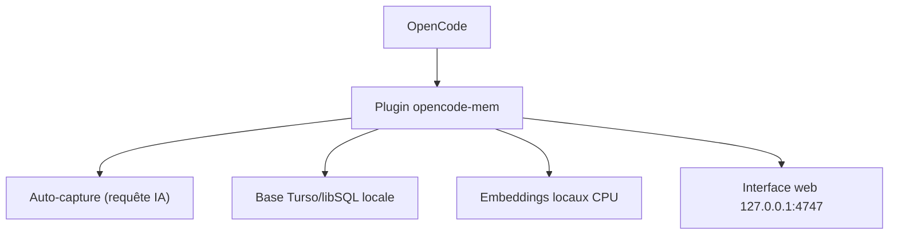

# tickernelz/opencode-mem

> A persistent memory plugin for the OpenCode coding agent, with local vector search.

## The problem
A coding agent forgets everything from one session to the next: project decisions, past mistakes and preferences have to be repeated.

## What it actually does
When a session is idle, an AI request summarizes the technical work and stores it in a local Turso/libSQL database with vectors. Relevant memories and a user profile are injected into the context. It masks credentials before capture, deduplicates, optionally encrypts the database and offers a web interface, a skills library and an export.

## How it is wired
Simplified diagram based on the sheet, no diagram provided.



## Trying it
```jsonc
// ~/.config/opencode/opencode.json (OpenCode v1)
{
  "plugin": ["opencode-mem@latest"]
}
```

## Cost and gotchas
Auto-capture needs an AI provider, at your expense. Local embeddings take about 0.5 to 2 GB of RAM and the model is downloaded on first use. Intel Mac not supported.

## What it is not
It is not reliable protection for secrets: credential removal is best-effort and does not cover every path. It is not a replacement for AGENTS.md.

## Alternatives
No alternative named in the README.

## For you
Worth watching: relevant if you use OpenCode daily and want a local project memory, but you must accept sending summaries to an AI provider.
