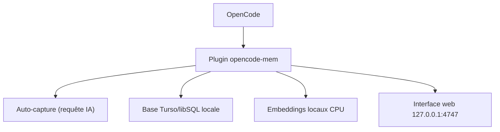

# tickernelz/opencode-mem

> Plugin de mémoire persistante pour l'agent de code OpenCode, avec recherche vectorielle locale.

## Le problème
Un agent de code oublie tout d'une session à l'autre : décisions de projet, erreurs passées et préférences sont à répéter.

## Ce que ça fait vraiment
Quand une session est inactive, une requête IA résume le travail technique et le range dans une base Turso/libSQL locale avec vecteurs. Les souvenirs pertinents et un profil d'utilisateur sont injectés dans le contexte. Il masque les identifiants avant capture, déduplique, chiffre la base en option et offre une interface web, une bibliothèque de skills et un export.

## Comment c'est branché
Schéma simplifié d'après la fiche, sans diagramme fourni.



## Essayer
```jsonc
// ~/.config/opencode/opencode.json (OpenCode v1)
{
  "plugin": ["opencode-mem@latest"]
}
```

## Coût et pièges
L'auto-capture a besoin d'un fournisseur IA, à ta charge. Les embeddings locaux prennent environ 0,5 à 2 Go de RAM et le modèle se télécharge au premier usage. Mac Intel non pris en charge.

## Ce que ce n'est pas
Ce n'est pas une protection fiable des secrets : la suppression des identifiants est faite au mieux et ne couvre pas tous les chemins. Ce n'est pas un remplaçant d'AGENTS.md.

## Alternatives
Aucune alternative nommée dans le README.

## Pour toi
À surveiller : pertinent si tu utilises OpenCode au quotidien et veux une mémoire de projet locale, mais il faut accepter l'envoi de résumés à un fournisseur IA.

