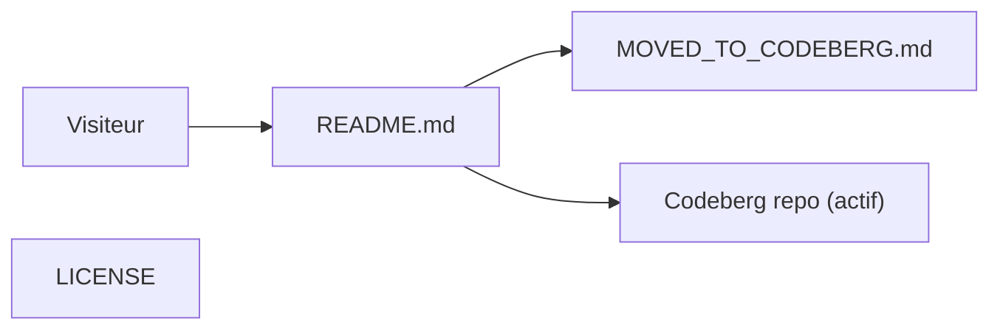

# tidalcycles/strudel

> Former Strudel repository, live coding of musical patterns in the browser, moved to Codeberg.

## The problem
Not applicable here: the repository now only serves to redirect to the new site.

## What it actually does
The README announces "Live coding patterns on the web" and states that development has moved to codeberg.org/uzu/strudel. According to the architecture, only README, MOVED_TO_CODEBERG.md and LICENSE remain.

## How it is wired

## Trying it
No command. The public site cited is https://strudel.cc/ and the active code is on Codeberg.

## Cost and gotchas
Nothing to install here. Do not follow this repository: it is archived.

## What it is not
Not the living project: no source code is present. Minimal fiche, as the README is under 800 characters.

## Alternatives
- codeberg.org/uzu/strudel: new address of the development.

## For you
Ignore: archived and empty of code; if musical live coding interests you, follow the Codeberg repository.
