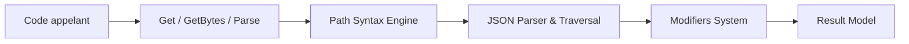

# tidwall/gjson

> Go package for quickly reading values from a JSON document with a simple path syntax.

## The problem
Extracting a field from JSON in Go forces you to define structs or decode into a `map`, with many allocations.

## What it actually does
`gjson.Get(json, "name.last")` returns the value without decoding everything. Dotted paths, wildcards, array indexes, `#(...)` queries, modifiers (`@reverse`, `@pretty`, `@flatten`, `@dig`…) extensible through `AddModifier`, JSON Lines with the `..` prefix, iteration with `ForEach`. The README gives benchmarks (202 ns/op, 0 allocations for `Get`) on a MacBook M1 Max: the author's own measurements.

## How it is wired


## Trying it
```bash
go get -u github.com/tidwall/gjson
```
```go
value := gjson.Get(json, "name.last")
println(value.String())
```

## Cost and gotchas
Free. The JSON must be well-formed: use `gjson.Valid` for an untrusted source (invalid JSON does not panic, but gives unpredictable results). 100 open issues.

## What it is not
It is not a modification tool: the README points to SJSON for writing and JJ for the command line.

## Alternatives
SJSON for modifying JSON and JJ on the command line, both by the same author; Python and Rust versions are mentioned.

## For you
Adopt if you write Go services or tools that read JSON logs or JSON Lines: lightweight, dependency-free, and an efficient syntax.
