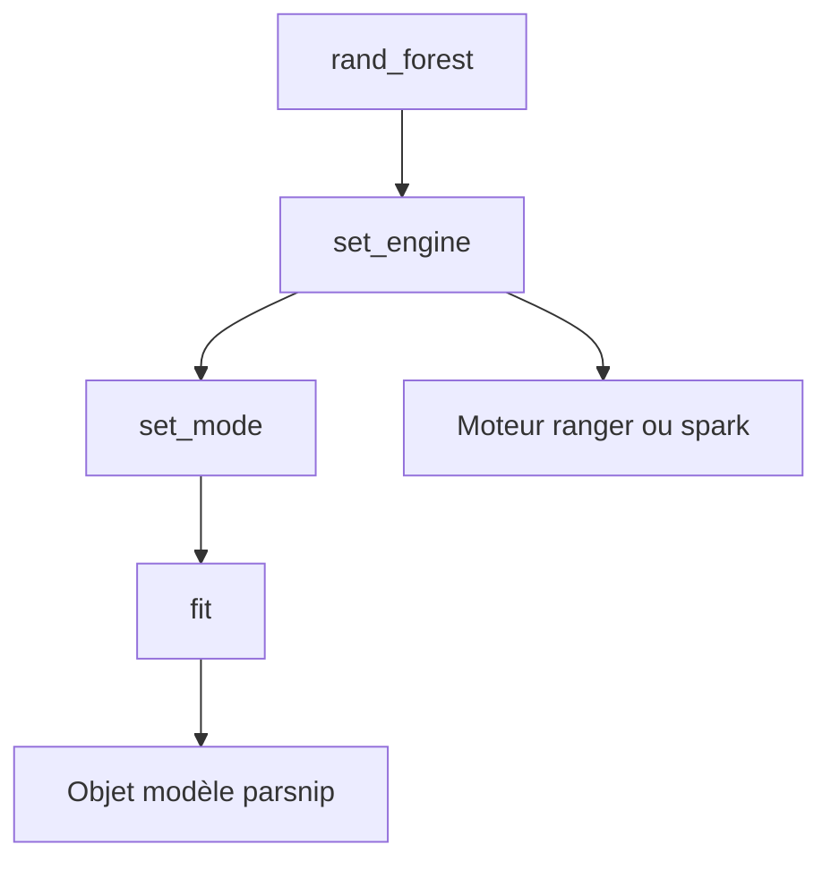

# tidymodels/parsnip

> Unified R interface to specify and fit models, whatever the underlying package.

## The problem
Each R modeling package has its own arguments: going from randomForest to ranger forces you to rewrite everything.

## What it actually does
Separates the model type, the mode (regression, classification) and the engine. You write `rand_forest(mtry = 10, trees = 2000)`, then `set_engine("ranger")` or `set_engine("spark")` and `fit`. Argument names are harmonized across models.

## How it is wired
Simplified diagram based on the sheet, no diagram provided.



## Trying it
```r
install.packages("tidymodels")
install.packages("parsnip")
pak::pak("tidymodels/parsnip")
```

## Cost and gotchas
Free. Requires R, absent from the prerequisites list, and the package of the chosen engine. License present but not identified by GitHub.

## What it is not
Not a new algorithm: it wraps existing engines, and does not concern Python.

## Alternatives
No alternative named in the README.

## For you
Worth watching: an R-side reference for interchangeable models, useful only if you work in R.
