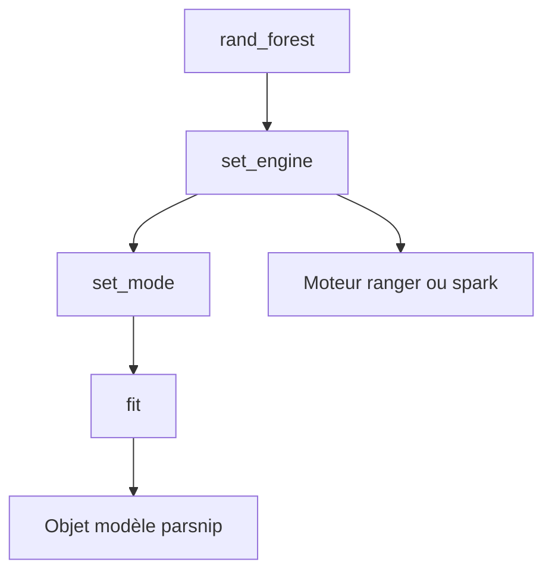

# tidymodels/parsnip

> Interface R unifiée pour spécifier et ajuster des modèles, quel que soit le paquet sous-jacent.

## Le problème
Chaque paquet R de modélisation a ses propres arguments : passer de randomForest à ranger oblige à tout réécrire.

## Ce que ça fait vraiment
Sépare le type de modèle, le mode (régression, classification) et le moteur. Tu écris `rand_forest(mtry = 10, trees = 2000)`, puis `set_engine("ranger")` ou `set_engine("spark")` et `fit`. Les noms d'arguments sont harmonisés entre modèles.

## Comment c'est branché
Schéma simplifié d'après la fiche, sans diagramme fourni.



## Essayer
```r
install.packages("tidymodels")
install.packages("parsnip")
pak::pak("tidymodels/parsnip")
```

## Coût et pièges
Gratuit. Il faut R, absent de la liste des prérequis, et le paquet du moteur choisi. Licence présente mais non identifiée par GitHub.

## Ce que ce n'est pas
Pas un nouvel algorithme : il enveloppe des moteurs existants, et ne concerne pas Python.

## Alternatives
Aucune alternative nommée dans le README.

## Pour toi
À surveiller : référence côté R pour des modèles interchangeables, utile seulement si tu travailles en R.

