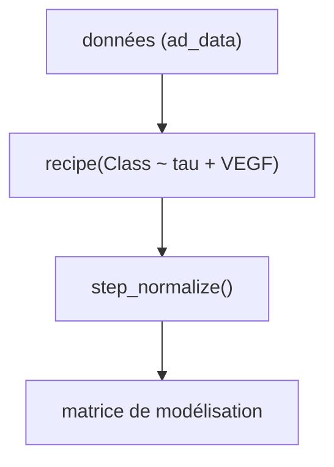

# tidymodels/recipes

> R preprocessing package: feature engineering steps chained with the pipe, to prepare data for modeling.

## The problem
R formulas and `model.matrix` limit how design matrices can be prepared, and preprocessing ends up scattered.

## What it actually does
You describe a `recipe` (outcome plus predictors) and then steps such as `step_normalize(all_numeric_predictors())`. The object serves as an alternative to formulas for producing modeling or visualization matrices. The README is short and points to the tidymodels.org site.

## How it is wired
Simplified diagram based on the sheet, no diagram provided.


## Trying it
```r
install.packages("recipes")
library(recipes)
data(ad_data, package = "modeldata")
ad_rec <- recipe(Class ~ tau + VEGF, data = ad_data) |>
  step_normalize(all_numeric_predictors())
```

## Cost and gotchas
Free. You need R. License present but not identified by GitHub: check it before any commercial use.

## What it is not
It is not a Python tool nor a model framework: it only prepares the data.

## Alternatives
No alternative named in the README.

## For you
Worth watching: very useful if you work in R and tidymodels, off-topic if you work in Python.
