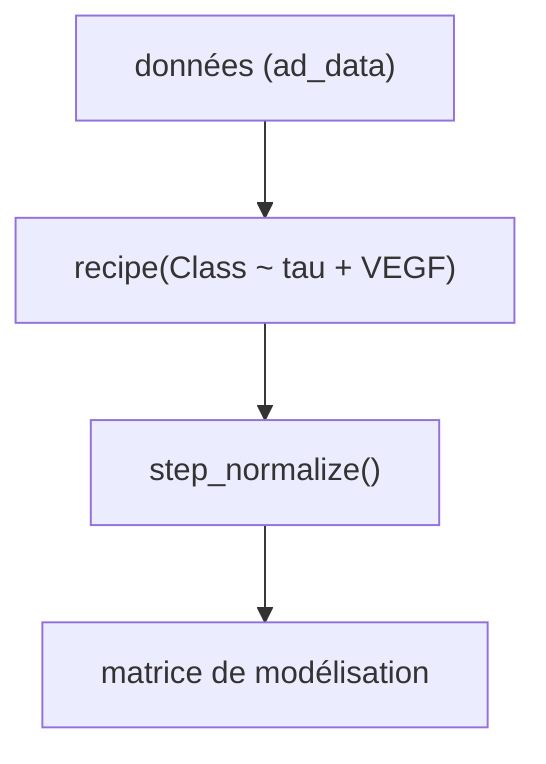

# tidymodels/recipes

> Paquet R de prétraitement : des étapes de feature engineering enchaînées avec le pipe, pour préparer des données de modélisation.

## Le problème
Les formules R et `model.matrix` limitent la préparation des matrices de design, et le prétraitement se disperse.

## Ce que ça fait vraiment
On décrit une `recipe` (résultat plus prédicteurs) puis des étapes comme `step_normalize(all_numeric_predictors())`. L'objet sert d'alternative aux formules pour produire des matrices de modélisation ou de visualisation. Le README est court et renvoie au site tidymodels.org.

## Comment c'est branché
Schéma simplifié d'après la fiche, sans diagramme fourni.


## Essayer
```r
install.packages("recipes")
library(recipes)
data(ad_data, package = "modeldata")
ad_rec <- recipe(Class ~ tau + VEGF, data = ad_data) |>
  step_normalize(all_numeric_predictors())
```

## Coût et pièges
Gratuit. Il faut R. Licence présente mais non identifiée par GitHub : à vérifier avant tout usage commercial.

## Ce que ce n'est pas
Ce n'est pas un outil Python ni un framework de modèles : il prépare les données seulement.

## Alternatives
Aucune alternative nommée dans le README.

## Pour toi
À surveiller : très utile si tu fais du R et tidymodels, hors sujet si tu travailles en Python.

