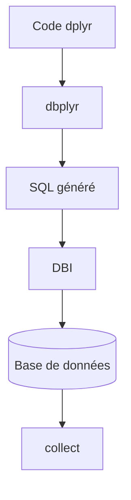

# tidyverse/dbplyr

> Translates R dplyr code into SQL to query databases like data frames.

## The problem
Writing SQL by hand for every analysis burdens R users. Loading whole tables into memory is costly.

## What it actually does
Remote tables are used like data frames. dplyr calls are lazily evaluated and converted to SQL, sent to the database only at `collect()`. `show_query()` displays the generated SQL. Connections go through the DBI package.

## How it is wired
Simplified diagram based on the sheet, no diagram provided.



## Trying it
```r
install.packages("dbplyr")
library(dplyr, warn.conflicts = FALSE)
con <- DBI::dbConnect(RSQLite::SQLite(), ":memory:")
copy_to(con, mtcars)
mtcars2 <- tbl(con, "mtcars")
mtcars2 |> group_by(cyl) |> summarise(mpg = mean(mpg, na.rm = TRUE)) |> show_query()
```

## Cost and gotchas
Free, installable from CRAN. You need a database and a DBI driver. The license is present but not identified by GitHub: check before use.

## What it is not
It is not a database engine nor a Python ORM. It only covers what dplyr can translate to SQL.

## Alternatives
No alternative named in the README.

## For you
Adopt if you do R analysis on SQL databases: a tidyverse pillar, proven since 2017.
