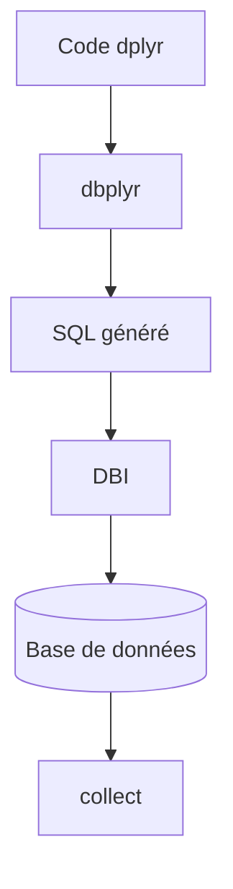

# tidyverse/dbplyr

> Traduit le code dplyr de R en SQL pour interroger des bases comme des data frames.

## Le problème
Écrire du SQL à la main pour chaque analyse alourdit le travail des utilisateurs de R. Charger les tables entières en mémoire est coûteux.

## Ce que ça fait vraiment
Les tables distantes s'utilisent comme des data frames. Les appels dplyr sont évalués paresseusement et convertis en SQL, envoyé à la base seulement à `collect()`. `show_query()` affiche le SQL généré. Les connexions passent par le paquet DBI.

## Comment c'est branché
Schéma simplifié d'après la fiche, sans diagramme fourni.



## Essayer
```r
install.packages("dbplyr")
library(dplyr, warn.conflicts = FALSE)
con <- DBI::dbConnect(RSQLite::SQLite(), ":memory:")
copy_to(con, mtcars)
mtcars2 <- tbl(con, "mtcars")
mtcars2 |> group_by(cyl) |> summarise(mpg = mean(mpg, na.rm = TRUE)) |> show_query()
```

## Coût et pièges
Gratuit, installable depuis CRAN. Il faut une base et un pilote DBI. La licence est présente mais non identifiée par GitHub : à vérifier avant usage.

## Ce que ce n'est pas
Ce n'est pas un moteur de base de données ni un ORM Python. Il ne couvre que ce que dplyr sait traduire en SQL.

## Alternatives
Aucune alternative nommée dans le README.

## Pour toi
À adopter si tu fais de l'analyse en R sur des bases SQL : pilier du tidyverse, éprouvé depuis 2017.

