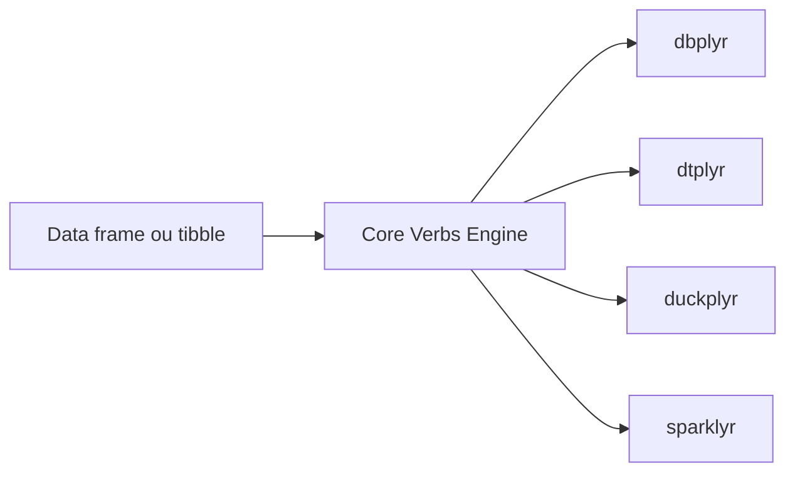

# tidyverse/dplyr

> Data manipulation grammar in R, with consistent verbs, for data scientists.

## The problem
Transforming tables in R calls for a uniform, readable syntax.

## What it actually does
Five verbs: `mutate`, `select`, `filter`, `summarise`, `arrange`, combinable with `group_by`, plus two-table verbs. The same verbs run on other engines: arrow, dbplyr (SQL), dtplyr (data.table), duckplyr (DuckDB), sparklyr (Spark).

## How it is wired


## Trying it
```r
install.packages("tidyverse")
install.packages("dplyr")
pak::pak("tidyverse/dplyr")
```

## Cost and gotchas
Free. License present but not identified by GitHub. Last push on 2026-06-02.

## What it is not
Not Python: for pandas or Polars, it is not the same library.

## Alternatives
- duckplyr: for large in-memory datasets via DuckDB.
- sparklyr: for very large volumes on Spark.

## For you
Worth watching: the reference if you use R; otherwise your Python ecosystem does not call for it.
