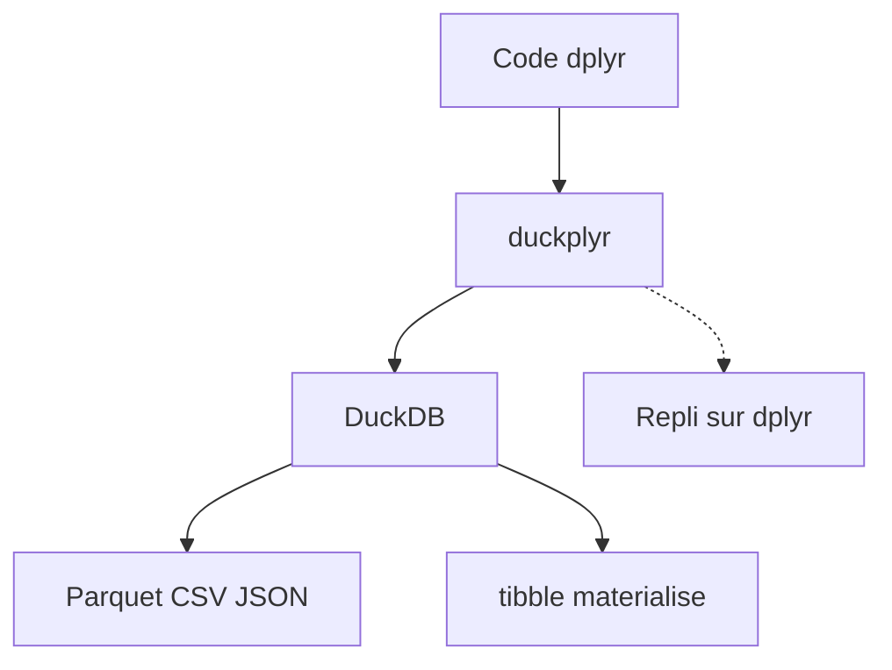

# tidyverse/duckplyr

> Drop-in replacement for dplyr in R that runs queries with DuckDB, for R users.

## The problem
dplyr is slow and memory-bound on large files, but rewriting your code in SQL is costly.

## What it actually does
After `library(duckplyr)`, existing dplyr code runs on DuckDB when possible, and falls back to dplyr otherwise. It reads Parquet, CSV and JSON, including remotely, with lazy evaluation. A materialization that is too large is refused by default to protect memory. Row order is not guaranteed.

## How it is wired
Simplified diagram based on the fiche, no diagram provided.



## Trying it
```bash
# Dans R :
# install.packages("duckplyr")
# library(duckplyr)
# duckplyr::methods_restore()
```

## Cost and gotchas
Free, requires R. License present but not identified by GitHub. Some types (time zones) are not handled. Fallback reports can be sent, but only when explicitly enabled.

## What it is not
Not a SQL generator or a multi-database connector: DuckDB only. No row-order guarantee as with dplyr.

## Alternatives
No alternative named in the README.

## For you
Adopt if you use R: a speed gain and data larger than memory without changing your code. Check the license for business use.
