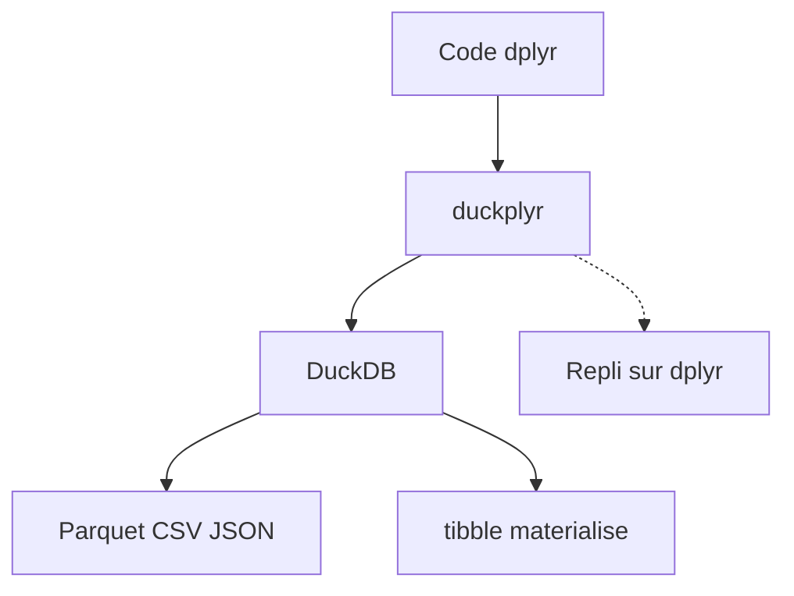

# tidyverse/duckplyr

> Remplaçant de dplyr en R qui exécute les requêtes avec DuckDB, pour les utilisateurs R.

## Le problème
dplyr est lent et limité par la mémoire sur de gros fichiers, mais réécrire son code en SQL coûte cher.

## Ce que ça fait vraiment
Après `library(duckplyr)`, le code dplyr existant tourne sur DuckDB quand c'est possible, et retombe sur dplyr sinon. Il lit Parquet, CSV et JSON, y compris à distance, avec évaluation paresseuse. Une matérialisation trop grosse est refusée par défaut pour protéger la mémoire. L'ordre des lignes n'est pas garanti.

## Comment c'est branché
Schéma simplifié d'après la fiche, sans diagramme fourni.



## Essayer
```bash
# Dans R :
# install.packages("duckplyr")
# library(duckplyr)
# duckplyr::methods_restore()
```

## Coût et pièges
Gratuit, demande R. Licence présente mais non identifiée par GitHub. Certains types (fuseaux horaires) ne sont pas gérés. Les fiches de repli peuvent être envoyées, mais uniquement sur activation explicite.

## Ce que ce n'est pas
Pas un générateur de SQL ni un connecteur multi-bases : DuckDB seulement. Pas de garantie d'ordre comme dplyr.

## Alternatives
Aucune alternative nommée dans le README.

## Pour toi
À adopter si tu fais du R : gain de vitesse et données plus grandes que la mémoire sans changer ton code. Vérifie la licence pour un usage en entreprise.

