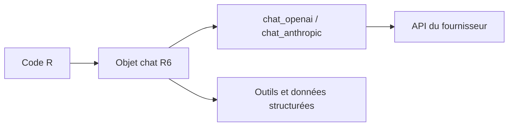

# tidyverse/ellmer

> R package for using language models from many providers, with streaming, tools and structured extraction.

## The problem
Calling several LLMs from R requires provider-specific code.

## What it actually does
Provides stateful chat objects, per provider (`chat_openai()`, `chat_anthropic()`, `chat_ollama()`, Bedrock, Azure, Gemini, Databricks, Snowflake). Streaming, tool calling, structured data, images, interactive console. Detects OAuth and IAM credentials of the major clouds.

## How it is wired
Simplified diagram based on the sheet, no diagram provided.


## Trying it
```r
install.packages("ellmer")
library(ellmer)
chat <- chat_openai("Be terse", model = "gpt-5.4-mini")
live_console(chat)
```

## Cost and gotchas
API key at your expense for OpenAI or Anthropic, stored in an environment variable. Free Gemini reuses your data. Ollama allows local use. Lifecycle announced as experimental.

## What it is not
It is not a Python client: Posit offers chatlas for that. It does not itself provide evaluation or RAG.

## Alternatives
- chatlas: Python equivalent.
- vitals: LLM evaluation.
- ragnar: RAG.

## For you
Watch: the reference if you work in R with LLMs, of no interest if your daily work is in Python.
