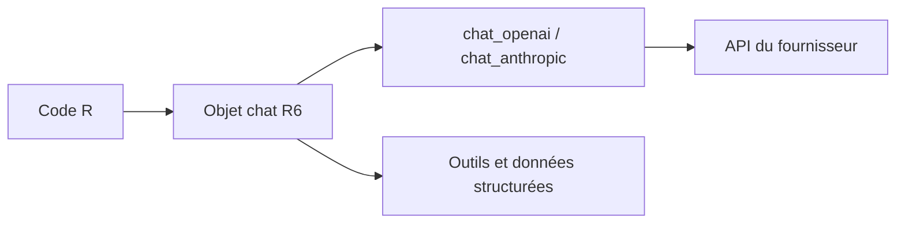

# tidyverse/ellmer

> Package R pour utiliser des modèles de langage de nombreux fournisseurs, avec streaming, outils et extraction structurée.

## Le problème
Appeler plusieurs LLM depuis R demande du code spécifique à chaque fournisseur.

## Ce que ça fait vraiment
Fournit des objets de chat avec état, par fournisseur (`chat_openai()`, `chat_anthropic()`, `chat_ollama()`, Bedrock, Azure, Gemini, Databricks, Snowflake). Streaming, appel d'outils, données structurées, images, console interactive. Détecte les identifiants OAuth et IAM des grands clouds.

## Comment c'est branché
Schéma simplifié d'après la fiche, sans diagramme fourni.


## Essayer
```r
install.packages("ellmer")
library(ellmer)
chat <- chat_openai("Be terse", model = "gpt-5.4-mini")
live_console(chat)
```

## Coût et pièges
Clé d'API à ta charge pour OpenAI ou Anthropic, stockée en variable d'environnement. Gemini gratuit réutilise tes données. Ollama permet un usage local. Cycle de vie annoncé expérimental.

## Ce que ce n'est pas
Ce n'est pas un client Python : Posit propose chatlas pour cela. Il ne fournit pas lui-même d'évaluation ou de RAG.

## Alternatives
- chatlas : équivalent Python.
- vitals : évaluation de LLM.
- ragnar : RAG.

## Pour toi
À surveiller : référence si tu travailles en R avec des LLM, sans intérêt si ton quotidien est en Python.

