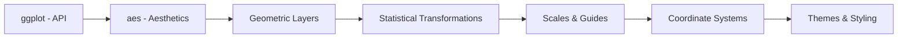

# tidyverse/ggplot2

> R package for declarative graphics based on the grammar of graphics, for analysts and data scientists.

## The problem
Imperative plotting tools force you to describe every graphical detail instead of linking data to aesthetics.

## What it actually does
You supply a dataset, `aes()` maps variables to visual attributes, then you stack layers (`geom_*`), scales, facets and coordinate systems. The code relies on `ggproto` (objects), themes and guides. The README notes that it changes little: innovation happens in extensions.

## How it is wired

Common engine: `ggproto`.

## Trying it
```r
install.packages("tidyverse")
install.packages("ggplot2")
pak::pak("tidyverse/ggplot2")

library(ggplot2)
ggplot(mpg, aes(displ, hwy, colour = class)) +
  geom_point()
```

## Cost and gotchas
Free, but requires R (not Python). License "present but not identified by GitHub": to be checked.

## What it is not
Not for Python; no interactive dashboards.

## Alternatives
No alternative named in the README (community extensions are mentioned).

## For you
Worth watching: a reference for visualization in R; if your stack is Python, it does not integrate directly.
