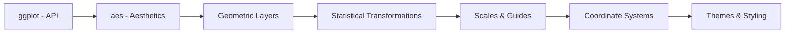

# tidyverse/ggplot2

> Paquet R de graphiques déclaratifs fondé sur la grammaire des graphiques, pour analystes et data scientists.

## Le problème
Les outils de tracé impératifs obligent à décrire chaque détail graphique au lieu de relier données et esthétiques.

## Ce que ça fait vraiment
Tu fournis un jeu de données, `aes()` associe variables et aspects visuels, puis tu empiles des couches (`geom_*`), échelles, facettes et systèmes de coordonnées. Le code s'appuie sur `ggproto` (objets), thèmes, guides. Le README note qu'il change peu : l'innovation se trouve dans les extensions.

## Comment c'est branché

Moteur commun : `ggproto`.

## Essayer
```r
install.packages("tidyverse")
install.packages("ggplot2")
pak::pak("tidyverse/ggplot2")

library(ggplot2)
ggplot(mpg, aes(displ, hwy, colour = class)) +
  geom_point()
```

## Coût et pièges
Gratuit, mais requiert R (pas Python). Licence « présente mais non identifiée par GitHub » : à vérifier.

## Ce que ce n'est pas
Pas pour Python ; pas de tableaux de bord interactifs.

## Alternatives
Aucune alternative nommée dans le README (extensions communautaires mentionnées).

## Pour toi
À surveiller : référence pour la visualisation en R ; si ton stack est Python, il ne s'y intègre pas directement.

