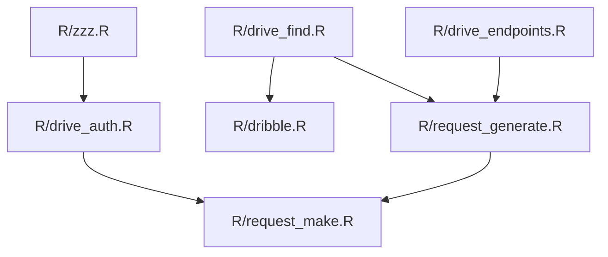

# tidyverse/googledrive

> R package to list, upload and download Google Drive files from R.

## The problem
Fetching or depositing files on Drive from an R script forces you to deal with the API and authentication.

## What it actually does
`drive_find`, `drive_upload` and `drive_download` build requests to the Drive v3 API. `drive_auth` provides the token, and results come back as a `dribble` table, compatible with the tidyverse.

## How it is wired
Diagram based on the code diagram.


## Trying it
```bash
Rscript -e 'install.packages("googledrive")'
Rscript -e 'pak::pak("tidyverse/googledrive")'
Rscript -e 'library("googledrive"); drive_find(n_max = 25)'
```

## Cost and gotchas
Free. A Google account and an OAuth authorization are required. A license is present but not identified by GitHub.

## What it is not
It is not a folder synchronization client. It depends entirely on Google Drive.

## Alternatives
No alternative named in the README.

## For you
Keep an eye on it: handy if your shared data lives on Drive and you work in R.
