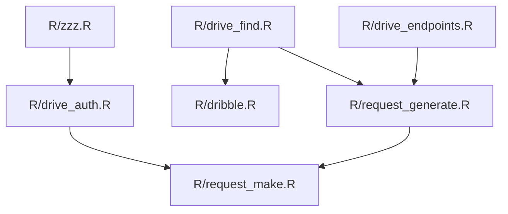

# tidyverse/googledrive

> Paquet R pour lister, téléverser et télécharger des fichiers Google Drive depuis R.

## Le problème
Récupérer ou déposer des fichiers sur Drive depuis un script R oblige à manipuler l'API et l'authentification.

## Ce que ça fait vraiment
`drive_find`, `drive_upload` et `drive_download` construisent des requêtes vers l'API Drive v3. `drive_auth` fournit le jeton, et les résultats reviennent sous forme de tableau `dribble`, compatible avec le tidyverse.

## Comment c'est branché
Schéma d'après le diagramme du code.


## Essayer
```bash
Rscript -e 'install.packages("googledrive")'
Rscript -e 'pak::pak("tidyverse/googledrive")'
Rscript -e 'library("googledrive"); drive_find(n_max = 25)'
```

## Coût et pièges
Gratuit. Un compte Google et une autorisation OAuth sont nécessaires. La licence est présente mais non identifiée par GitHub.

## Ce que ce n'est pas
Ce n'est pas un client de synchronisation de dossiers. Il dépend entièrement de Google Drive.

## Alternatives
Aucune alternative nommée dans le README.

## Pour toi
À surveiller : pratique si tes données partagées vivent sur Drive et que tu travailles en R.

