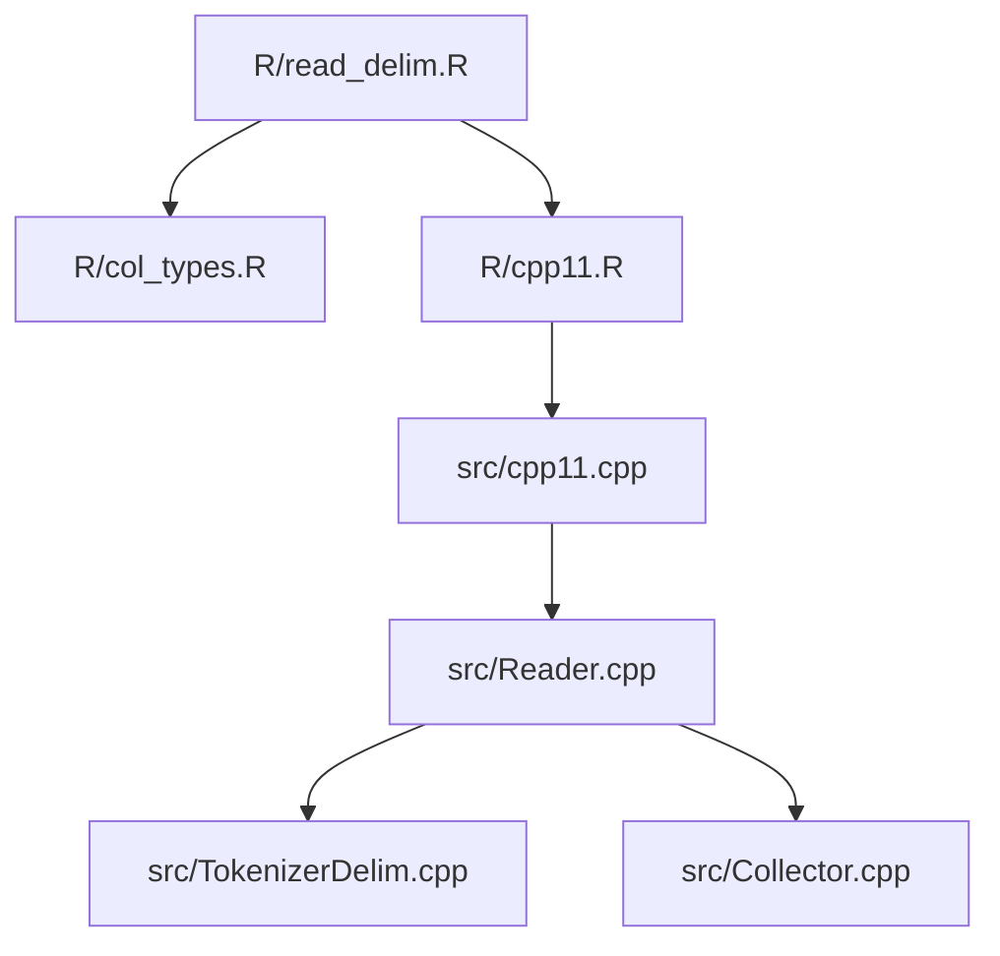

# tidyverse/readr

> R package for quickly reading rectangular files such as CSV, TSV and similar, with problem reporting.

## The problem
Reading delimited files with guessed column types produces silent errors.

## What it actually does
Functions `read_csv`, `read_tsv`, `read_csv2`, `read_delim`, `read_fwf`, `read_table`, `read_log`. Guesses column types, then `spec()` lets you make them explicit. From the code, `read_delim.R` resolves the source and types, and calls the C++ engine via cpp11; `Reader.cpp` splits with `TokenizerDelim` and converts with the collectors. Since version 2.0.0 the engine is vroom.

## How it is wired


## Trying it
```r
install.packages("readr")
library(readr)
spec(chickens)
```

## Cost and gotchas
Free. R is required. Guessed types are only guesses: make them explicit as soon as the project matures. License not identified by GitHub.

## What it is not
Not made for Python, nor for non-rectangular files.

## Alternatives
`fread()` from data.table (faster on numeric data) and base R functions.

## For you
Worth watching: the reference for data import in R, but of little use if you mostly work in Python.
