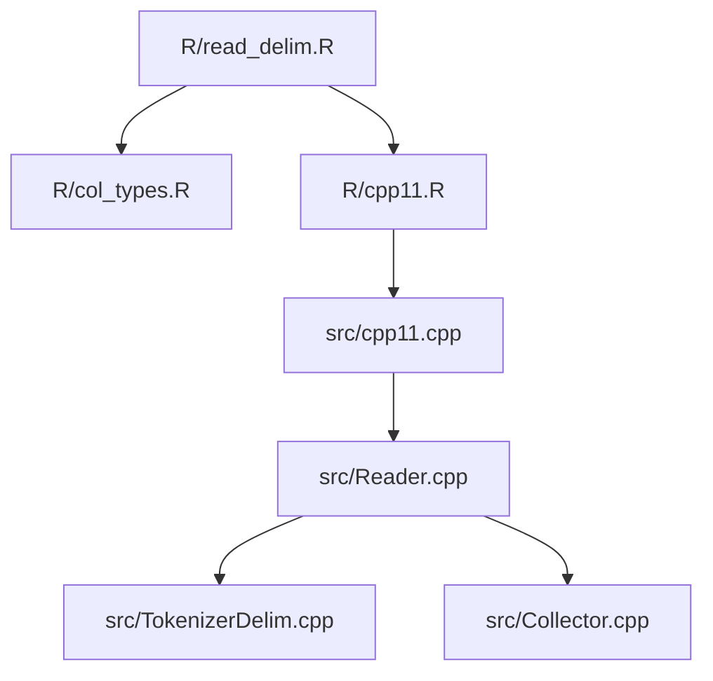

# tidyverse/readr

> Paquet R pour lire rapidement des fichiers rectangulaires CSV, TSV et similaires, avec rapport de problèmes.

## Le problème
Lire des fichiers délimités avec des types de colonnes devinés produit des erreurs silencieuses.

## Ce que ça fait vraiment
Fonctions `read_csv`, `read_tsv`, `read_csv2`, `read_delim`, `read_fwf`, `read_table`, `read_log`. Devine les types de colonnes, puis `spec()` permet de les expliciter. D'après le code, `read_delim.R` résout la source et les types, appelle le moteur C++ via cpp11 ; `Reader.cpp` découpe avec `TokenizerDelim` et convertit avec les collecteurs. Depuis la version 2.0.0 le moteur est vroom.

## Comment c'est branché


## Essayer
```r
install.packages("readr")
library(readr)
spec(chickens)
```

## Coût et pièges
Gratuit. Il faut R. Les types devinés ne sont que des suppositions : à expliciter dès que le projet mûrit. Licence non identifiée par GitHub.

## Ce que ce n'est pas
Pas fait pour Python, ni pour des fichiers non rectangulaires.

## Alternatives
`fread()` de data.table (plus rapide sur le numérique) et les fonctions de base R.

## Pour toi
À surveiller : référence de l'import de données en R, mais peu utile si tu travailles surtout en Python.

