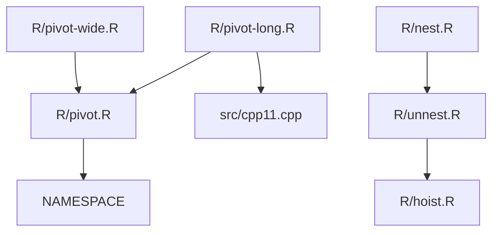

# tidyverse/tidyr

> R package for putting data into tidy format: pivots, nesting, splitting and missing values.

## The problem
Badly structured tables waste time before the analysis even starts.

## What it actually does
Five families: pivot_longer and pivot_wider, rectangling of nested lists (JSON) with unnest_longer, unnest_wider and hoist, nest and unnest, splitting and uniting columns, handling NAs (complete, drop_na, fill, replace_na). A C++ layer via cpp11 speeds up some operations.

## How it is wired


## Trying it
```r
install.packages("tidyverse")
install.packages("tidyr")
pak::pak("tidyverse/tidyr")
library(tidyr)
```

## Cost and gotchas
Free. Requires R. A license is present but not identified by GitHub: to be checked. Replaces spread and gather with the pivots.

## What it is not
Not an aggregation or modeling tool, nor a generic reshape. Not as fast as data.table.

## Alternatives
data.table (melt, dcast), reshape2 and reshape, which tidyr replaces.

## For you
Adopt if you do analysis in R: the de facto standard for data cleaning; in Python, pandas plays this role.
