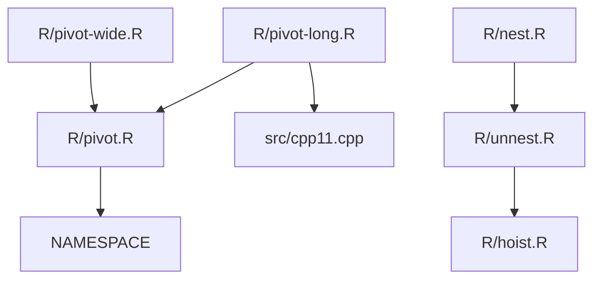

# tidyverse/tidyr

> Package R pour mettre les données au format tidy : pivots, imbrication, séparation et valeurs manquantes.

## Le problème
Des tableaux mal structurés font perdre du temps avant même l'analyse.

## Ce que ça fait vraiment
Cinq familles : pivot_longer et pivot_wider, rectangling de listes imbriquées (JSON) avec unnest_longer, unnest_wider et hoist, nest et unnest, séparation et union de colonnes, gestion des NA (complete, drop_na, fill, replace_na). Une couche C++ via cpp11 accélère certaines opérations.

## Comment c'est branché


## Essayer
```r
install.packages("tidyverse")
install.packages("tidyr")
pak::pak("tidyverse/tidyr")
library(tidyr)
```

## Coût et pièges
Gratuit. Nécessite R. Licence présente mais non identifiée par GitHub : à vérifier. Remplace spread et gather par les pivots.

## Ce que ce n'est pas
Pas un outil d'agrégation ni de modélisation, ni un reshape générique. Pas rapide comme data.table.

## Alternatives
data.table (melt, dcast), reshape2 et reshape, que tidyr remplace.

## Pour toi
Adopter si tu fais de l'analyse en R : standard de fait du nettoyage de données ; en Python, pandas joue ce rôle.

