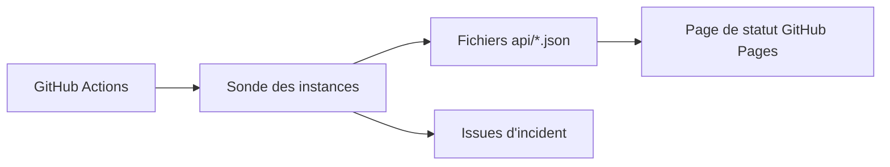

# tiekoettercom/searx-instances-uptime

> Availability monitor and status page for SearXNG instances, powered by Upptime on GitHub.

## The problem
Knowing which public SearXNG instances respond, without a dedicated server.

## What it actually does
Upptime uses Issues as incident reports, Actions as availability probes and Pages for the status page. The README is mostly a table of instances (searx.tiekoetter.com, paulgo.io, etc.) with response time and uptime rate.

## How it is wired
Simplified diagram based on the sheet, no diagram provided.


## Trying it
```bash
# Aucune commande documentée.
```

## Cost and gotchas
Relies on GitHub Actions, Issues and Pages. README truncated in the block, only partly read.

## What it is not
Not a search engine: an outage tracking page. It only covers the listed instances.

## Alternatives
None named in the README.

## For you
Ignore: SearXNG instance monitoring unrelated to data/AI work; Upptime remains a simple model for a status page.
