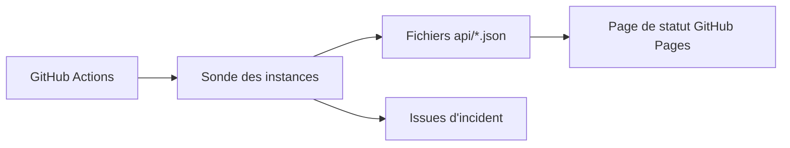

# tiekoettercom/searx-instances-uptime

> Moniteur de disponibilité et page de statut d'instances SearXNG, propulsé par Upptime sur GitHub.

## Le problème
Savoir quelles instances publiques SearXNG répondent, sans serveur dédié.

## Ce que ça fait vraiment
Upptime utilise les Issues comme rapports d'incident, Actions comme sondes de disponibilité et Pages pour la page de statut. Le README est surtout un tableau d'instances (searx.tiekoetter.com, paulgo.io, etc.) avec temps de réponse et taux de disponibilité.

## Comment c'est branché
Schéma simplifié d'après la fiche, sans diagramme fourni.


## Essayer
```bash
# Aucune commande documentée.
```

## Coût et pièges
Repose sur GitHub Actions, Issues et Pages. README tronqué dans le bloc, lu en partie seulement.

## Ce que ce n'est pas
Pas un moteur de recherche : une page de suivi de pannes. Elle ne couvre que les instances listées.

## Alternatives
Aucune nommée dans le README.

## Pour toi
À ignorer : surveillance d'instances SearXNG sans lien avec un travail data/IA ; Upptime reste un modèle simple pour une page de statut.

