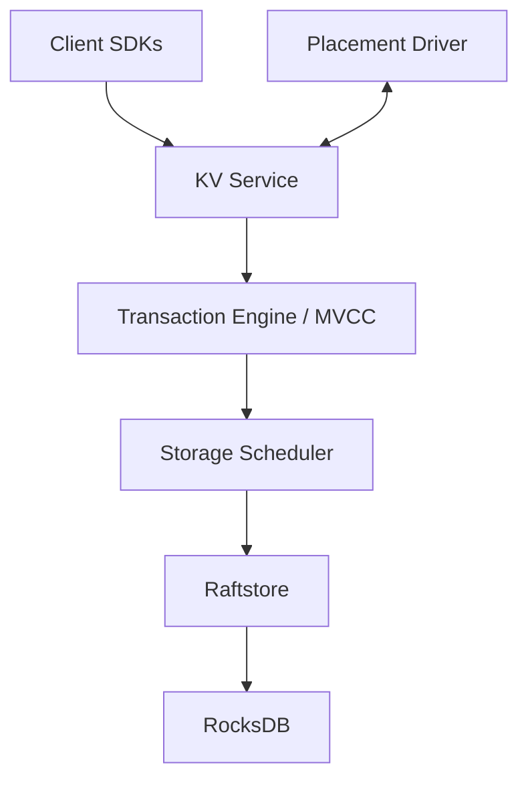

# tikv/tikv

> Distributed, transactional key-value database written in Rust, replicated with Raft.

## The problem
Storing large quantities of key-value pairs with transactions across several nodes, without a single point of failure.

## What it actually does
Data is split into Regions, each replicated across several nodes as a Raft group. Each Store contains a RocksDB. The Placement Driver (PD) manages the cluster and balances the load. Layers described: KV service, storage (MVCC, transactions, raw KV), raftstore, engine. Go, Java, Rust, C clients.

## How it is wired


## Trying it
```bash
./pd-server --name=pd --data-dir=/tmp/pd/data --client-urls="http://127.0.0.1:2379" --peer-urls="http://127.0.0.1:2380" --initial-cluster="pd=http://127.0.0.1:2380" --log-file=/tmp/pd/log/pd.log
./tikv-server --pd-endpoints="127.0.0.1:2379" --addr="127.0.0.1:20160" --data-dir=/tmp/tikv/data --log-file=/tmp/tikv/log/tikv.log
docker-compose up -d
```

## Cost and gotchas
Free. A minimal cluster requires PD plus TiKV; the Docker Compose example launches 3 PD and 3 TiKV. The binary is only supported for darwin and linux.

## What it is not
Not a SQL database: it is a key-value layer, usually paired with TiDB. Not a tool to set up solo without any notion of clusters.

## Alternatives
No alternative named in the README.

## For you
Watch: worth knowing for distributed storage underneath a data platform, heavy to operate for a simple use.
