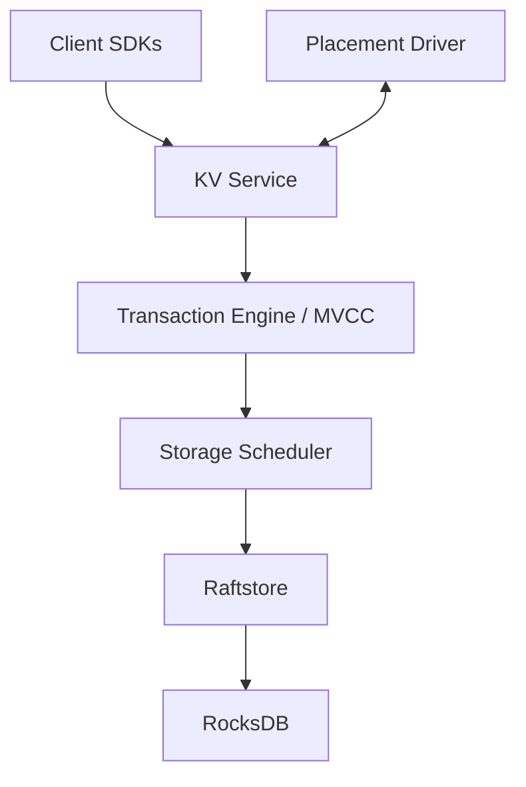

# tikv/tikv

> Base de données clé-valeur distribuée et transactionnelle, écrite en Rust, répliquée par Raft.

## Le problème
Stocker de grandes quantités de paires clé-valeur avec transactions sur plusieurs nœuds, sans point unique de défaillance.

## Ce que ça fait vraiment
Les données sont découpées en Regions, chacune répliquée sur plusieurs nœuds en groupe Raft. Chaque Store contient un RocksDB. Le Placement Driver (PD) gère le cluster et équilibre la charge. Couches décrites : service KV, stockage (MVCC, transactions, raw KV), raftstore, moteur. Clients Go, Java, Rust, C.

## Comment c'est branché


## Essayer
```bash
./pd-server --name=pd --data-dir=/tmp/pd/data --client-urls="http://127.0.0.1:2379" --peer-urls="http://127.0.0.1:2380" --initial-cluster="pd=http://127.0.0.1:2380" --log-file=/tmp/pd/log/pd.log
./tikv-server --pd-endpoints="127.0.0.1:2379" --addr="127.0.0.1:20160" --data-dir=/tmp/tikv/data --log-file=/tmp/tikv/log/tikv.log
docker-compose up -d
```

## Coût et pièges
Gratuit. Un cluster minimal exige PD plus TiKV ; l'exemple Docker Compose lance 3 PD et 3 TiKV. Le binaire n'est pris en charge que pour darwin et linux.

## Ce que ce n'est pas
Pas une base SQL : c'est une couche clé-valeur, qu'on associe à TiDB. Pas un outil à mettre en place en solo sans notion de cluster.

## Alternatives
Aucune alternative nommée dans le README.

## Pour toi
Surveiller : à connaître pour un stockage distribué sous une plateforme de données, lourd à opérer pour un usage simple.

