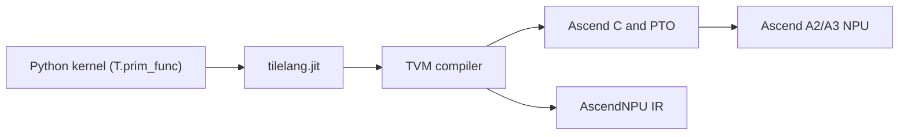

# tile-ai/tilelang-ascend

> Python kernel language for programming Huawei Ascend NPUs, for AI operator engineers.

## The problem
Writing compute kernels (GEMM, attention) for Ascend NPUs by hand, in Ascend C, is slow and hard to optimize.

## What it actually does
A variant of tile-lang built on TVM. Kernels are written in Python syntax (`T.Kernel`, `T.copy`, `T.gemm_v0`): the compiler targets Ascend C and PTO, or AscendNPU IR. It offers automatic synchronization insertion, buffer reuse, pipelines, and workspace allocation. Tested on A2 and A3 NPUs.

## How it is wired
Simplified diagram based on the fiche, no diagram provided.



## Trying it
```bash
source {your-cann-installed-path}/ascend-toolkit/set_env.sh
export ASCEND_HOME_PATH=/usr/local/Ascend/ascend-toolkit/latest
pip install tilelang-*.whl
cd examples/gemm
python example_gemm.py
```

## Cost and gotchas
Requires Huawei Ascend hardware, CANN 8.3.RC1 minimum, and torch-npu 2.6.0.RC1 minimum. The wheel is downloaded separately, otherwise it must be compiled. Continuous integration is run manually. More than 550 open issues.

## What it is not
Not a training framework nor an NVIDIA GPU version: it's a backend dedicated to Ascend NPUs.

## Alternatives
No alternative named in the README (the README points to the tile-lang project it derives from).

## For you
To watch: interesting only if you optimize kernels on Ascend NPUs; unusable without this hardware.
