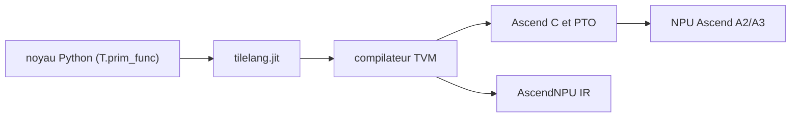

# tile-ai/tilelang-ascend

> Langage de noyaux Python pour programmer les NPU Huawei Ascend, pour ingénieurs d'opérateurs IA.

## Le problème
Écrire des noyaux de calcul (GEMM, attention) pour les NPU Ascend à la main, en Ascend C, est lent et difficile à optimiser.

## Ce que ça fait vraiment
Variante de tile-lang bâtie sur TVM. On écrit des noyaux en syntaxe Python (`T.Kernel`, `T.copy`, `T.gemm_v0`) : le compilateur vise Ascend C et PTO, ou AscendNPU IR. Il offre insertion automatique des synchronisations, réutilisation de tampons, pipelines et allocation de workspace. Testé sur les NPU A2 et A3.

## Comment c'est branché
Schéma simplifié d'après la fiche, sans diagramme fourni.



## Essayer
```bash
source {your-cann-installed-path}/ascend-toolkit/set_env.sh
export ASCEND_HOME_PATH=/usr/local/Ascend/ascend-toolkit/latest
pip install tilelang-*.whl
cd examples/gemm
python example_gemm.py
```

## Coût et pièges
Exige du matériel Huawei Ascend, CANN 8.3.RC1 minimum et torch-npu 2.6.0.RC1 minimum. Le wheel se télécharge séparément, sinon il faut compiler. L'intégration continue se lance à la main. Plus de 550 issues ouvertes.

## Ce que ce n'est pas
Pas un framework d'entraînement ni une version pour GPU NVIDIA : c'est un backend dédié aux NPU Ascend.

## Alternatives
Aucune alternative nommée dans le README (le README renvoie au projet tile-lang dont il dérive).

## Pour toi
Surveiller : intéressant seulement si tu optimises des noyaux sur NPU Ascend ; sans ce matériel, inutilisable.

